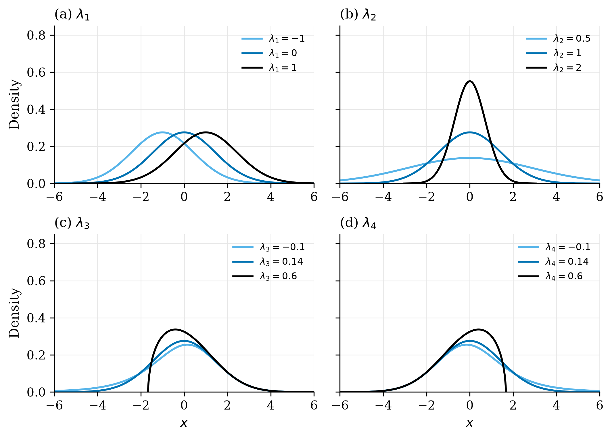

.. _`sec:gld`:

The generalized lambda distribution
===================================

From the density to the quantile function
-----------------------------------------

A continuous random variable :math:`X` is usually presented to students through its cumulative distribution function (CDF),

.. math::

   F(x) = P(X \leq x),

and its probability density function (PDF), :math:`f(x) = F'(x)`, whose integral over an interval gives the probability of observing a value in it, :math:`P(a < X \leq b) = \int_a^b f(x)\,dx`. A third description, equivalent and less explored in teaching, is the quantile function :ref:`[7] <ref-gilchrist2000>`,

.. _eq:quantil:

.. math::

   Q(u) = F^{-1}(u), \qquad 0 < u < 1,
   \tag{2}

which answers the inverse question, namely, what is the value :math:`x` below which a fraction :math:`u` of the observations lies. When :math:`F` is not strictly increasing, :math:`Q(u)` is defined as the smallest :math:`x` such that :math:`F(x) \geq u`. The reading is direct and is made in the units of the quantity, since :math:`Q(0.5)` is the median and :math:`Q(0.95)` is the value exceeded in only :math:`5\%` of the occurrences.

For a continuous distribution that is strictly increasing on its support, :math:`F(Q(u)) = u` holds. Differentiating both sides with respect to :math:`u` gives :math:`f(Q(u))\,Q'(u) = 1`, that is,

.. _eq:densidade_quantil:

.. math::

   f(Q(u)) = \frac{1}{Q'(u)},
   \tag{3}

so the density can be drawn parametrically, taking :math:`x = Q(u)` and :math:`f = 1/Q'(u)` for a grid of values of :math:`u`, without having to invert the quantile function.

An explicit expression for :math:`Q` has a second advantage, which is the ease of generating samples. If :math:`U` is uniform on :math:`(0,1)`, then :math:`X = Q(U)` has distribution :math:`F`, since :math:`P(Q(U) \leq x) = P(U \leq F(x)) = F(x)`. This is the inverse transform method. In the case studies of this paper, however, the starting point is always observed data.

Code :ref:`1 <lst:quantil>` shows these two operations with the ``pyglam`` library :ref:`[15] <ref-pyglam>`, used throughout the paper. The quantile function is evaluated by the ``ppf`` method, and sampling by inverse transform by the ``rvs`` method.

.. _lst:quantil:

**Code 1. Quantiles and sampling of a GLD-FKML with the ``pyglam`` library.**

.. code-block:: python

   import numpy as np
   from pyglam import GlamFKML

   # GLD-FKML with lambda = (0, 1, 0.14, 0.14), a shape close to the normal
   model = GlamFKML(0.0, 1.0, 0.14, 0.14)

   # quantiles read directly from the quantile function Q(u)
   median, p95 = model.ppf([0.50, 0.95])

   # sampling by inverse transform, X = Q(U)
   sample = model.rvs(size=1000, random_state=42)

The FKML formulation and the meaning of the parameters
------------------------------------------------------

The generalized lambda distribution, in the parameterization of Freimer and coworkers :ref:`[10] <ref-freimer1988>`, is defined by the quantile function

.. _eq:fkml:

.. math::

   Q(u) = \lambda_1 + \frac{1}{\lambda_2}
       \left[\frac{u^{\lambda_3} - 1}{\lambda_3} - \frac{(1-u)^{\lambda_4} - 1}{\lambda_4}\right],
       \qquad 0 < u < 1, \quad \lambda_2 > 0,
   \tag{4}

where, for :math:`\lambda_3 = 0` or :math:`\lambda_4 = 0`, each fraction is replaced by its limit, :math:`\lim_{a \to 0} (u^a - 1)/a = \ln u`.

The role of each parameter is summarized in Table :ref:`2 <tab:parametros>` and illustrated in Figure :ref:`1 <fig:parametros>`, in which one parameter varies at a time and the others are held fixed. Parameter :math:`\lambda_1` shifts the distribution without changing its shape. Parameter :math:`\lambda_2` inversely controls the scale, so that doubling it halves the dispersion. Parameters :math:`\lambda_3` and :math:`\lambda_4` control the shape, acting mainly on the left and right sides of the distribution, respectively. Positive values make the corresponding tail bounded. The value zero produces an unbounded tail with exponential decay, and negative values an unbounded and heavier tail, with power-law decay. If :math:`X` has a physical unit, :math:`\lambda_1` has that unit, :math:`\lambda_2` has the inverse unit, and the shape parameters are dimensionless.

.. _tab:parametros:

.. container::

   .. table:: Table 2. Pedagogical interpretation of the parameters of the GLD-FKML.

      +--------------------------------------+---------------------------------------------------------------------+------------------------------------------------------------------------------------------+
      | **Parameter**                        | **Interpretation**                                                  | **Caution**                                                                              |
      +======================================+=====================================================================+==========================================================================================+
      | :math:`\lambda_1`                    | Shifts the distribution                                             | Generally neither the mean nor the median                                                |
      +--------------------------------------+---------------------------------------------------------------------+------------------------------------------------------------------------------------------+
      | :math:`\lambda_2`                    | Inversely controls the scale                                        | Not the standard deviation. Increasing it, with the others fixed, reduces the dispersion |
      +--------------------------------------+---------------------------------------------------------------------+------------------------------------------------------------------------------------------+
      | :math:`\lambda_3`, :math:`\lambda_4` | Jointly control the shape, with effects on the left and right sides | Do not identify one of them exclusively with skewness and the other with kurtosis        |
      +--------------------------------------+---------------------------------------------------------------------+------------------------------------------------------------------------------------------+

.. _fig:parametros:

   Figure 1. Densities of the GLD-FKML varying one parameter at a time, starting from :math:`\boldsymbol\lambda = (0,\, 1,\, 0.14,\, 0.14)`, a shape close to the normal, with (a) the shift by :math:`\lambda_1`, (b) the scale by :math:`\lambda_2`, (c) the left side by :math:`\lambda_3`, and (d) the right side by :math:`\lambda_4`.

Validity, support, and moments
------------------------------

Not every set of parameters defines a distribution, since the quantile function must be increasing. Differentiating Eq. :ref:`(4) <eq:fkml>`,

.. _eq:qlinha:

.. math::

   Q'(u) = \frac{u^{\lambda_3 - 1} + (1-u)^{\lambda_4 - 1}}{\lambda_2},
   \tag{5}

whose numerator is positive for any real :math:`\lambda_3` and :math:`\lambda_4`. In the FKML parameterization, therefore, :math:`\lambda_2 > 0` is enough for the distribution to be valid.

The support, that is, the interval of possible values, goes from :math:`a = Q(0^+)` to :math:`b = Q(1^-)`, given by

.. _eq:suporte:

.. math::

   a = \begin{cases}
           \lambda_1 - \dfrac{1}{\lambda_2 \lambda_3}, & \lambda_3 > 0, \\[6pt]
           -\infty, & \lambda_3 \leq 0,
       \end{cases}
       \qquad
       b = \begin{cases}
           \lambda_1 + \dfrac{1}{\lambda_2 \lambda_4}, & \lambda_4 > 0, \\[6pt]
           +\infty, & \lambda_4 \leq 0.
       \end{cases}
   \tag{6}

Here the first bridge to physics appears. A mathematically valid distribution may assign probability to physically impossible values, such as negative speeds, or exclude values that were actually observed. For this reason, the support is examined after every fit in this paper.

Validity and the existence of moments are distinct properties. The moment of order :math:`k` exists when :math:`\lambda_3, \lambda_4 > -1/k`. Fitting by the first four moments therefore requires :math:`\lambda_3, \lambda_4 > -1/4`.

The method of moments, step by step
-----------------------------------

The idea of the method of moments, proposed for the generalized lambda family by Ramberg and coworkers :ref:`[9] <ref-ramberg1979>`, is to choose the parameters so that the summary characteristics of the model coincide with those of the sample. For observations :math:`x_1, \ldots, x_n`, define

.. _eq:momentos_amostra:

.. math::

   \bar x = \frac{1}{n}\sum_{i=1}^{n} x_i, \qquad
       m_k = \frac{1}{n}\sum_{i=1}^{n} (x_i - \bar x)^k, \qquad
       \widehat\gamma_1 = \frac{m_3}{m_2^{3/2}}, \qquad
       \widehat\beta_2 = \frac{m_4}{m_2^{2}},
   \tag{7}

that is, the mean, the variance (with divisor :math:`n`), the skewness, and the kurtosis. Pearson’s kurtosis, :math:`\widehat\beta_2`, equals :math:`3` for the normal and measures the weight of the observations far from the center. It is not simply a measure of the height of the peak. The fit looks for parameters :math:`\boldsymbol\lambda` that satisfy

.. _eq:sistema:

.. math::

   \mu(\boldsymbol\lambda) = \bar x, \qquad
       \sigma^2(\boldsymbol\lambda) = m_2, \qquad
       \gamma_1(\boldsymbol\lambda) = \widehat\gamma_1, \qquad
       \beta_2(\boldsymbol\lambda) = \widehat\beta_2.
   \tag{8}

The moments of the model follow directly from the quantile function. Since :math:`X = Q(U)`, with :math:`U` uniform,

.. math::

   E[X^r] = \int_0^1 Q(u)^r \, du,

and, for the mean, it suffices to integrate Eq. :ref:`(4) <eq:fkml>` term by term, using :math:`\int_0^1 (u^{\lambda} - 1)/\lambda \, du = -1/(\lambda + 1)`, which gives

.. _eq:media:

.. math::

   E[X] = \lambda_1 + \frac{1}{\lambda_2}
       \left[\frac{1}{1 + \lambda_4} - \frac{1}{1 + \lambda_3}\right].
   \tag{10}

The higher-order moments follow the same path and result in combinations of beta functions of the shape parameters :ref:`[10] <ref-freimer1988>`, :ref:`[11] <ref-karian2011>`. The notebook that accompanies the paper evaluates them numerically.

The system in Eq. :ref:`(8) <eq:sistema>` is nonlinear and is solved numerically. The fitting procedure has five steps.

#. Compute the four sample summaries of Eq. :ref:`(7) <eq:momentos_amostra>`.

#. Propose initial parameters.

#. Compute the model moments and the discrepancies with respect to those of the sample.

#. Update the parameters until the discrepancies vanish.

#. Check the validity, the moment domain, the support, and the goodness of fit to the data.

In the ``pyglam`` library :ref:`[15] <ref-pyglam>`, the function ``fit_lambdas`` carries out steps 2 to 4 by minimizing, in the least-squares sense, the scaled residuals of the four relations, starting from several initial points. In this paper, :math:`15` points were used, the first built from the sample mean and standard deviation and the others taken from a fixed grid that covers bounded shapes, shapes close to the exponential, and heavy tails. Among the solutions obtained, the library prefers those that define a valid distribution and lie within the moment domain, chooses the one with the smallest residual and, when several residuals are numerically equivalent, breaks the tie by the smallest distance between the model quantiles and the sample quantiles. All attempts are recorded in the fit result, which allows the student to inspect the non-uniqueness discussed next. The last step is up to the user, and it is the one on which the case studies concentrate.

What the fit by moments guarantees and what must be evaluated
-------------------------------------------------------------

Reproducing the four sample moments does not identify a single distribution, since, even within the FKML family, different parameters can have the same four moments :ref:`[11] <ref-karian2011>`. Moreover, high-order moments are sensitive to a few extreme values, and the numerical success of the optimizer does not tell whether the model represents the data well. Checking the moments and evaluating the goodness of fit are therefore complementary steps. The flexibility of the family, in turn, is not the same as the capability of a specific estimator, since an unfavorable result obtained by the method of moments does not show that no GLD would describe the data. Alternative estimators exist, such as the method of percentiles, the method of L-moments, and maximum likelihood :ref:`[11] <ref-karian2011>`, :ref:`[18] <ref-su2007>`. The latter, by construction, accepts only parameters whose support contains all the observations, a property that the method of moments does not guarantee and whose importance will become clear in the wind case study.
