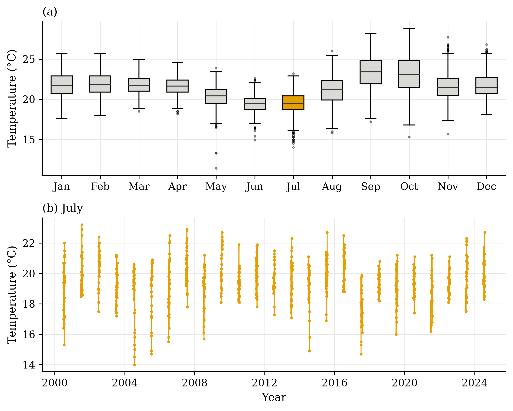
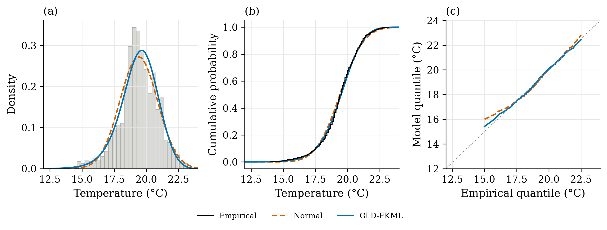

.. _`sec:temperatura`:

Distribution fitting and interpretation of temperature data
===========================================================

Why this quantity?
------------------

Air temperature is one of the most familiar thermodynamic quantities in everyday life and in elementary scientific experimentation.

In introductory physics and engineering courses, it is often assumed, as a tacit premise, that continuous quantities behave in a Gaussian way. However, the physical quantity “temperature” does not by itself determine a normal distribution. A series aggregated over several years incorporates strong seasonal effects and air-mass transitions that produce the superposition of populations with distinct means and variances.

This second example complements the wind example. Whereas for wind the support restriction and the positive skewness were investigated, for temperature we examine to what extent an approximately symmetric distribution justifies abandoning the normal distribution in favor of a flexible four-parameter family.

Definition of the time window
-----------------------------

The analysis of the complete multiyear series reveals an evident seasonal variation, which rules out a single model for the whole year without stratification. To keep a more homogeneous physical and temporal window, the daily mean temperature of the month of July was selected. The window comprises :math:`768` valid daily observations, distributed over 25 winters (2000 to 2024).

The choice of July was made *a priori*, on the basis of a climatological criterion (the height of winter in the Brazilian Central-West region), and not through an exploratory search for the month with the best fit to the normal or to the GLD. Restricting the data to one month attenuates the heterogeneity between seasons, although it does not eliminate the dependence between adjacent days or the interannual variability. The fitted model is to be interpreted as the probabilistic characterization of the daily mean temperatures observed in July at that weather station.

Figure :ref:`4 <fig:temp_sazonalidade>` illustrates the annual cycle of temperature at the station through the monthly distribution and highlights the July series. Panel (b) also shows that some winters, such as those of 2004 and 2017, had days much colder than the others.

.. _fig:temp_sazonalidade:

   Figure 4. Daily mean temperature at station A001, with (a) the distribution by month, highlighting July, and (b) the series of July temperatures, from 2000 to 2024.

Distribution performance and interpretation
-------------------------------------------

The July sample (Table :ref:`7 <tab:descritiva_temperatura>`) has a mean temperature of :math:`19.409\,^\circ\text{C}`, a standard deviation of :math:`1.466\,^\circ\text{C}` (with divisor :math:`n`), moderately negative skewness (:math:`-0.482`), and a Pearson kurtosis of :math:`3.717`, that is, an excess of :math:`0.717` relative to the normal. The empirical 5%, 50%, and 95% quantiles are :math:`16.84\,^\circ\text{C}`, :math:`19.50\,^\circ\text{C}`, and :math:`21.70\,^\circ\text{C}`, respectively.

.. _tab:descritiva_temperatura:

.. container::

   .. table:: Table 7. Descriptive statistics of the daily mean temperature in July. Standard deviation with divisor :math:`n` and Pearson kurtosis (equal to :math:`3` for the normal).

      +------------------------------------------------------+------------------------------------------+
      | **Statistic**                                        | **July temperature (:math:`^\circ`\ C)** |
      +======================================================+==========================================+
      | :math:`n`                                            | 768                                      |
      +------------------------------------------------------+------------------------------------------+
      | Mean                                                 | 19.409                                   |
      +------------------------------------------------------+------------------------------------------+
      | Median                                               | 19.50                                    |
      +------------------------------------------------------+------------------------------------------+
      | Standard deviation                                   | 1.466                                    |
      +------------------------------------------------------+------------------------------------------+
      | Skewness                                             | :math:`-0.482`                           |
      +------------------------------------------------------+------------------------------------------+
      | Kurtosis (Pearson)                                   | 3.717                                    |
      +------------------------------------------------------+------------------------------------------+
      | Minimum, maximum                                     | 14.0, 23.2                               |
      +------------------------------------------------------+------------------------------------------+
      | :math:`Q_{0.05}`, :math:`Q_{0.50}`, :math:`Q_{0.95}` | 16.84, 19.50, 21.70                      |
      +------------------------------------------------------+------------------------------------------+

Applying the same protocol as in Section :ref:`4 <sec:vento>`, the normal model, with maximum likelihood parameters :math:`\widehat{\mu} = 19.409\,^\circ\text{C}` and :math:`\widehat{\sigma} = 1.466\,^\circ\text{C}`, was compared with the GLD-FKML fitted by the method of moments with the ``pyglam`` library, which gave :math:`\widehat{\boldsymbol\lambda} = (19.538,\, 1.0707,\, 0.0175,\, 0.1836)`.

The quantile discrepancies are reported directly in the physical unit (:math:`\Delta_p`, in :math:`^\circ`\ C). Table :ref:`8 <tab:desempenho_temperatura>` presents the comparative diagnostics, and Figure :ref:`5 <fig:diagnosticos_temperatura>` summarizes the overlay of the densities, the cumulative distribution functions, and the Q-Q plot.

.. _tab:desempenho_temperatura:

.. container::

   .. table:: Table 8. Performance of the models fitted to the daily mean temperatures in July. The quantile differences :math:`\Delta_p` are in :math:`^\circ`\ C.

      +-----------+----------------+-----------------+---------------------------+---------------------------+---------------------------+
      | **Model** | **Parameters** | **:math:`D_n`** | **:math:`\Delta_{0.05}`** | **:math:`\Delta_{0.50}`** | **:math:`\Delta_{0.95}`** |
      +===========+================+=================+===========================+===========================+===========================+
      | Normal    | 2              | 0.064           | :math:`+0.163`            | :math:`-0.091`            | :math:`+0.120`            |
      +-----------+----------------+-----------------+---------------------------+---------------------------+---------------------------+
      | GLD-FKML  | 4              | 0.041           | :math:`+0.025`            | :math:`+0.002`            | :math:`-0.058`            |
      +-----------+----------------+-----------------+---------------------------+---------------------------+---------------------------+

.. _fig:diagnosticos_temperatura:

   Figure 5. Comparative diagnostics of the July temperatures, with (a) densities overlaid on the histogram, (b) cumulative distribution functions, and (c) quantile-quantile plot, in which the dotted line indicates perfect agreement. As in Figure :ref:`3 <fig:diagnosticos>`, the Q-Q plot uses the 1% to 99% percentiles.

Physical and pedagogical interpretation
---------------------------------------

In this example, the choice between the normal and the GLD-FKML relies on the principle of parsimony (Occam’s razor). The fitted normal distribution shows a small Kolmogorov-Smirnov distance (:math:`D_n = 0.064`), and the quantile deviations are on the order of tenths of a degree Celsius (:math:`+0.16\,^\circ\text{C}` at the 5% quantile and :math:`+0.12\,^\circ\text{C}` at the 95% quantile).

To decide whether these discrepancies justify a more complex model, the scale used here is the sampling uncertainty of the empirical quantiles themselves. Sensor uncertainty was not included, because the series does not carry enough instrumental metadata to estimate it. Simulating independent samples of :math:`768` values from the fitted GLD, the standard deviation of the empirical 5% quantile is about :math:`0.15\,^\circ\text{C}`, and that of the 95% quantile about :math:`0.09\,^\circ\text{C}`. Temperatures on consecutive days, however, are strongly correlated (autocorrelation coefficient of :math:`0.65`), and Julys of different years may be systematically colder or warmer, so the sample contains less independent information than the :math:`768` values suggest. Resampling whole years by *bootstrap* (Code :ref:`5 <lst:bootstrap_anos>`), which preserves these two sources of dependence, the standard deviations of the 5%, 50%, and 95% quantiles rise to :math:`0.38`, :math:`0.10`, and :math:`0.21\,^\circ\text{C}`. The deviations of the normal (:math:`+0.16`, :math:`-0.09`, and :math:`+0.12\,^\circ\text{C}`) are smaller than these standard deviations. The comparison is descriptive, not a test, but it shows that, at the three quantiles examined, the normal errs less than the quantiles themselves vary from one resample to another. The :math:`D_n` of the normal, about twice the 5% critical value of the Lilliefors test for independent observations (:math:`0.886/\sqrt{n} \approx 0.032`) :ref:`[22] <ref-lilliefors1967>`, suggests a difference in shape, but the dependence between days makes this critical value optimistic, and the result is not conclusive. In such cases, even if the GLD-FKML accommodates the negative skewness and reduces :math:`D_n` to :math:`0.041`, with quantile deviations below :math:`0.06\,^\circ\text{C}`, the addition of two free parameters calls for critical judgment, since, for many usual thermal applications, the two-parameter normal model offers a simple and sufficient description.

.. _lst:bootstrap_anos:

**Code 5. Uncertainty of the empirical quantiles of the July temperatures by *bootstrap* resampling of whole years.**

.. code-block:: python

   # one array of temperatures for each July (each year is a block)
   df["data"] = pd.to_datetime(df["data"])
   july = df[(df["data"].dt.month == 7) & df["temperatura_c"].notna()]
   years = [g["temperatura_c"].to_numpy() for _, g in july.groupby(july["data"].dt.year)]

   rng = np.random.default_rng(0)
   p = [0.05, 0.50, 0.95]
   Q = []
   for _ in range(1000):
       draw = rng.integers(0, len(years), len(years))        # years drawn with replacement
       sample = np.concatenate([years[i] for i in draw])     # joins the drawn Julys
       Q.append(np.quantile(sample, p))

   print(np.std(Q, axis=0))     # standard deviation of the empirical quantiles across resamples

The support of the fitted GLD reinforces this reading. With :math:`\lambda_3` and :math:`\lambda_4` positive, the model is bounded on both sides, between :math:`-33.9\,^\circ\text{C}` and :math:`24.6\,^\circ\text{C}` (computed with the unrounded parameters, available in the supplementary material; with the values printed above one obtains :math:`-33.8\,^\circ\text{C}`). The lower limit is very sensitive to :math:`\lambda_3`, since, with :math:`\lambda_3 = 0.018`, for example, it would change to about :math:`-32.3\,^\circ\text{C}`, which already shows that this number has no physical meaning. The upper limit is plausible, slightly above the observed maximum of :math:`23.2\,^\circ\text{C}`. The lower one is physically implausible for Brasília in July, although the model assigns negligible probability to that region, because a very small :math:`\lambda_3` produces a long and extremely thin left tail. The support limits are therefore a mathematical consequence of the parameters, and are not to be read as physical limits of the quantity.

On the other hand, if the focus is on estimating intense cold events (left tail), the negative skewness captured by the GLD gains relevance. A plausible physical explanation is the occasional passage of cold fronts and incursions of polar cold air that reach Central Brazil in winter :ref:`[25] <ref-garreaud2000>` and can produce isolated days much colder than average, without a mechanism of equal intensity on the warm side. This work did not associate the cold days in the sample with specific events. The explanation is, therefore, a hypothesis compatible with the observed skewness. The estimated quantiles describe the variability of the daily mean temperatures in the observed history of the month, but they do not represent confidence intervals for the sample mean, sensor limits, or a forecast for a specific day.
