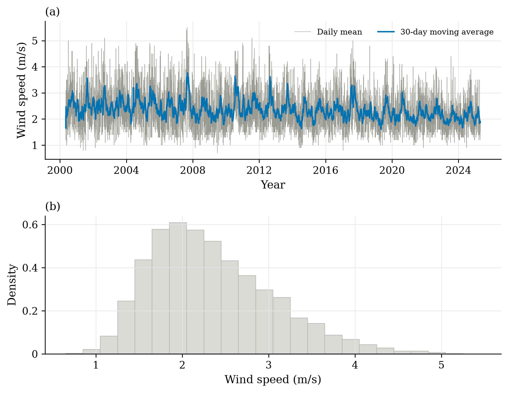
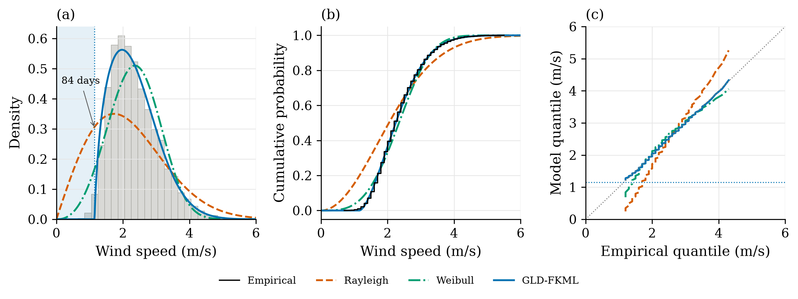

.. _`sec:vento`:

Distribution fitting and interpretation of wind data
====================================================

Brief presentation of the library and the environment
-----------------------------------------------------

To carry out this case study and reproduce the proposed fits, we use the ``pyglam`` library (version 1.1.0) :ref:`[15] <ref-pyglam>`, developed in Python and publicly available, and the classical distributions of the ``scipy.stats`` library :ref:`[16] <ref-scipy2020>`. The package implements the FKML parameterization of the generalized lambda family and its fit by the method of moments, described in Section :ref:`2 <sec:gld>`.

The following resources of the ``pyglam`` library are used in this study: ``GlamFKML``, to instantiate the parametric model, ``fit_lambdas``, to run the fitting algorithm, and the methods ``pdf`` (probability density function), ``cdf`` (cumulative distribution function), and ``ppf`` (quantile function, from *percent point function*). The ``rvs`` method generates random samples by inverse transform. The fitting function returns the optimizer solution (``sol.x``), and the user explicitly instantiates the fitted model (``gld = GlamFKML(*sol.x)``) instead of modifying the original instance.

Origin, units, and quality of the data
--------------------------------------

The empirical data used in this study are the daily mean wind speeds (in m/s) from automatic weather station A001 of the Brazilian National Institute of Meteorology (INMET), in Brasília (DF), obtained from the INMET Meteorological Database :ref:`[24] <ref-inmet2025>`. The station, with WMO code 86715, is located at about :math:`15.79^\circ` S and :math:`47.93^\circ` W, at an altitude of :math:`1161` m, and has operated since May 2000. It was the first automatic station of the INMET network. The file covers the period from 6 May 2000 to 25 April 2025, with 9,121 daily records without repeated dates, of which 8,840 contain the wind speed and 281 are empty. There are no zero or negative records, and the values appear in the file with a step of :math:`0.1\,\text{m/s}`. This is the recording step (rounding) of the data, which is not to be confused with the metrological resolution of the anemometer, not documented in the file.

The daily values were used as provided by INMET, without recomputing the means. There are 101 gaps between valid records, the longest lasting 29 days. Because the whole period is analyzed together, the target here is the aggregate historical distribution of the daily means, which mixes the seasons of the year, and not that of a specific season. The monthly mean varies from about :math:`2.10` to :math:`2.75\,\text{m/s}` over the year.

The valid daily speeds range from a minimum of :math:`0.7\,\text{m/s}` to a maximum of :math:`5.5\,\text{m/s}`, with a sample mean of :math:`2.345\,\text{m/s}` and a standard deviation of :math:`0.711\,\text{m/s}` (computed with divisor :math:`n`).

Exploratory characterization
----------------------------

Analyzing the data, we find that the daily mean wind speed is positively skewed, bounded below by the physical zero, and extends into a right tail that accommodates exceptionally windy days.

Figure :ref:`2 <fig:exploratoria>` shows the time series and the histogram, highlighting the concentration of the probability mass in the range from :math:`1.5` to :math:`3.0\,\text{m/s}`. Table :ref:`4 <tab:descritiva_vento>` gathers the descriptive statistics, including the 5%, 50%, and 95% quantiles, which serve as a numerical reference for evaluating the fitted curves.

.. _fig:exploratoria:

   Figure 2. Daily mean wind speed at automatic station A001, in Brasília (DF), with (a) the time series and the 30-day moving average and (b) the histogram.

.. _tab:descritiva_vento:

.. container::

   .. table:: Table 4. Descriptive statistics of the daily mean wind speed. Standard deviation with divisor :math:`n` and Pearson kurtosis (equal to :math:`3` for the normal).

      ==================================================== ================
      **Statistic**                                        **Wind (m/s)**
      ==================================================== ================
      :math:`n`                                            8,840
      Mean                                                 2.345
      Median                                               2.20
      Standard deviation                                   0.711
      Coefficient of variation                             0.303
      Skewness                                             0.738
      Kurtosis (Pearson)                                   3.368
      Minimum, maximum                                     0.7, 5.5
      :math:`Q_{0.05}`, :math:`Q_{0.50}`, :math:`Q_{0.95}` 1.40, 2.20, 3.70
      ==================================================== ================

Compared families and estimation
--------------------------------

The statistical fit compares three parametric models, the GLD-FKML and two classical reference models with the origin fixed at the physical zero, the Rayleigh distribution (one parameter) and the Weibull distribution (two parameters), both fitted by maximum likelihood.

Adopting the Rayleigh distribution in the atmospheric setting assumes the hypotheses of Section :ref:`3 <sec:dados>` (Gaussian, orthogonal, and independent wind components), formulated for speeds over short intervals. Applying it to daily means deliberately tests a model outside its domain of validity, which illustrates the importance of the definition of the variable. The maximum likelihood estimator for this family is :math:`\widehat\sigma = \sqrt{\sum_{i=1}^n v_i^2 / (2n)}`, which gives :math:`\widehat\sigma = 1.733\,\text{m/s}`. However, a structural limitation arises immediately from the data, because the coefficient of variation (CV) of the Rayleigh distribution with origin at zero is a constant, :math:`\sqrt{(4-\pi)/\pi} \approx 0.523`, regardless of :math:`\sigma`. By contrast, the empirical CV of the daily sample analyzed is :math:`0.303`. This discrepancy prevents the Rayleigh model from adapting to the shape of the observed distribution, whatever its scale. Part of it is expected, because the mean over a day combines dozens of readings and therefore varies relatively less from one day to the next than the speed over one hour.

Introducing the Weibull model relaxes this restriction by incorporating a shape parameter (the Rayleigh being its particular case when this parameter equals :math:`2`). The fit gives shape :math:`\widehat k = 3.448` and scale :math:`\widehat c = 2.605\,\text{m/s}`, which offers a fairer basis of comparison with the flexibility of the four parameters of the GLD-FKML.

The solution obtained for the GLD-FKML, :math:`\widehat{\boldsymbol\lambda} = (2.191,\, 1.727,\, 0.555,\, 0.099)`, reproduces the four sample moments. Since :math:`\lambda_3` and :math:`\lambda_4` are positive, Eq. :ref:`(6) <eq:suporte>` indicates that the fitted model has bounded support, from :math:`1.148` to :math:`8.057\,\text{m/s}`, whereas the observed data range from :math:`0.7` to :math:`5.5\,\text{m/s}`. The consequence of this result is discussed in Section :ref:`4.6 <subsec:vento_interpretacao>`.

Code :ref:`2 <lst:ajuste>`, which continues Code :ref:`1 <lst:quantil>`, performs this fit, computes the support limits by Eq. :ref:`(6) <eq:suporte>`, and counts the observations that fall outside it.

.. _lst:ajuste:

**Code 2. Fit of the GLD-FKML to the wind data by the method of moments and check of the support.**

.. code-block:: python

   import pandas as pd

   df = pd.read_csv("estacao_A001_diario.csv")
   v = df["vento_ms"].dropna().to_numpy()         # daily mean wind speeds (m/s)

   # method of moments from 15 starting points
   sol = GlamFKML().fit_lambdas(v, n_starts=15, seed=0)
   gld = GlamFKML(*sol.x)                         # fitted model
   l1, l2, l3, l4 = sol.x

   # support limits, as in the support equation
   a = l1 - 1 / (l2 * l3) if l3 > 0 else -np.inf
   b = l1 + 1 / (l2 * l4) if l4 > 0 else np.inf
   outside = np.sum((v < a) | (v > b))            # observations outside the support

Distribution performance and interpretation
-------------------------------------------

The quality of the fit is evaluated by two measures. The first is dimensionless and the second is expressed in the unit of the quantity (m/s), which allows the discrepancies to be interpreted physically.

#. **Global goodness of fit:** Kolmogorov-Smirnov distance, :math:`D_n = \sup_v |F_n(v) - \widehat{F}(v)|`, which quantifies the largest absolute deviation between the empirical cumulative distribution and that of the model.

#. **Deviations in the tails and at the center:** quantile differences :math:`\Delta_p` from Eq. :ref:`(14) <eq:delta>`, at the percentiles :math:`p \in \{0.05,\, 0.50,\, 0.95\}`. The sign of :math:`\Delta_p` immediately indicates whether the model underestimates (negative) or overestimates (positive) the wind speed, in m/s.

Code :ref:`3 <lst:avaliacao>` computes the two metrics for the GLD fitted in Code :ref:`2 <lst:ajuste>`. For the Rayleigh and Weibull models, it suffices to replace ``gld`` with the corresponding distribution from the ``scipy.stats`` library, which offers the same ``ppf`` and ``cdf`` methods.

.. _lst:avaliacao:

**Code 3. Quantile deviations and Kolmogorov-Smirnov distance of the fitted model.**

.. code-block:: python

   # quantile deviations, in m/s
   p = np.array([0.05, 0.50, 0.95])
   delta = gld.ppf(p) - np.quantile(v, p)

   # Kolmogorov-Smirnov distance between the empirical CDF and the model CDF
   x = np.sort(v)
   n = x.size
   F = gld.cdf(x)
   i = np.arange(1, n + 1)
   Dn = max(np.max(i / n - F), np.max(F - (i - 1) / n))

Table :ref:`5 <tab:desempenho_vento>` compiles these metrics. Figure :ref:`3 <fig:diagnosticos>` brings together the density, the cumulative distribution function, and the Q-Q plot, making it possible to locate at which quantiles each model departs from the data. In (a) and (c), the shaded band and the horizontal line mark the lower limit of the GLD support (:math:`1.148\,\text{m/s}`), below which there are :math:`84` days of the sample, whose importance is discussed in Section :ref:`4.6 <subsec:vento_interpretacao>`. Because the Q-Q plot uses the 1% to 99% percentiles and these days correspond to :math:`0.95\%` of the sample, they do not appear in it.

.. _tab:desempenho_vento:

.. container::

   .. table:: Table 5. Performance of the models fitted to the daily wind data. The quantile differences :math:`\Delta_p` are in m/s.

      +-----------+----------------+-----------------+---------------------------+---------------------------+---------------------------+
      | **Model** | **Parameters** | **:math:`D_n`** | **:math:`\Delta_{0.05}`** | **:math:`\Delta_{0.50}`** | **:math:`\Delta_{0.95}`** |
      +===========+================+=================+===========================+===========================+===========================+
      | Rayleigh  | 1              | 0.242           | :math:`-0.845`            | :math:`-0.159`            | :math:`+0.542`            |
      +-----------+----------------+-----------------+---------------------------+---------------------------+---------------------------+
      | Weibull   | 2              | 0.085           | :math:`-0.299`            | :math:`+0.142`            | :math:`-0.119`            |
      +-----------+----------------+-----------------+---------------------------+---------------------------+---------------------------+
      | GLD-FKML  | 4              | 0.041           | :math:`-0.025`            | :math:`+0.046`            | :math:`-0.037`            |
      +-----------+----------------+-----------------+---------------------------+---------------------------+---------------------------+

.. _fig:diagnosticos:

   Figure 3. Comparative diagnostics of the models fitted to the wind data, with (a) densities overlaid on the histogram, (b) cumulative distribution functions, and (c) quantile-quantile plot, in which the dotted diagonal line indicates perfect agreement.

.. _`subsec:vento_interpretacao`:

Physical and pedagogical interpretation
---------------------------------------

The results show that the fixed coefficient of variation of the Rayleigh distribution makes it too wide for these data. It underestimates the 5% quantile by :math:`0.845\,\text{m/s}` and the median by :math:`0.159\,\text{m/s}`, and overestimates the 95% quantile by :math:`0.542\,\text{m/s}`, being inadequate to describe the daily regime at this site. The Weibull model improves the fit considerably, but still errs on the 5% quantile by :math:`0.299\,\text{m/s}` and on the median by :math:`0.142\,\text{m/s}`.

The GLD-FKML, which reproduces the skewness and kurtosis of the sample, reduces the distance :math:`D_n` to half of that obtained with the Weibull and keeps the three quantile deviations below :math:`0.05\,\text{m/s}`, smaller than the recording step of :math:`0.1\,\text{m/s}` of the data.

To judge whether these differences are relevant, a comparison scale is needed, and the first is the rounding of the data. Because the records have a step of :math:`0.1\,\text{m/s}`, the empirical cumulative distribution advances in steps, and no continuous distribution can have an arbitrarily small :math:`D_n`. To quantify this effect, independent samples of :math:`8{,}840` values were simulated from the fitted GLD itself (Code :ref:`4 <lst:arredondamento>`). Without rounding, :math:`D_n` is about :math:`0.008`. When the samples are rounded to :math:`0.1\,\text{m/s}`, the median rises to :math:`0.034`, and :math:`95\%` of the simulations fall below :math:`0.039`. In the simulations, therefore, rounding alone brings :math:`D_n` close to the observed value. This does not break the GLD’s :math:`D_n = 0.041` down into parts, since the observed value lies slightly above the 95th percentile of the simulation, and the simulation ignores the dependence between days and the fact that the parameters were estimated from the same data. The comparison gives the expected order of magnitude, not a test.

The second scale is the sampling variability. The mean speed of one day is correlated with that of the next day (autocorrelation of :math:`0.65` between pairs of consecutive calendar days). After removing the annual cycle, that is, subtracting from each day the mean of its month, the autocorrelation falls below :math:`0.1` from about five days onward, which motivated blocks of ten days in the *bootstrap*. The blocks are drawn only from stretches of the calendar without gaps, so that no block joins dates separated by a gap. With blocks of 5, 20, or 30 days the results change little (standard deviation from :math:`0.021` to :math:`0.026\,\text{m/s}` for the median and from :math:`0.053` to :math:`0.060\,\text{m/s}` for the 95% quantile). In each resample the two models were refitted, so that Table :ref:`6 <tab:incerteza_vento>` shows the variability of the deviation :math:`\Delta_p` itself, and not only that of the empirical quantile.

.. _lst:arredondamento:

**Code 4. Effect of the rounding of the records on the Kolmogorov-Smirnov distance, assuming the fitted GLD to be the true distribution.**

.. code-block:: python

   # Kolmogorov-Smirnov distance between a sample and the model CDF
   def dist_ks(sample, cdf):
       x = np.sort(sample)
       n = x.size
       F = cdf(x)
       i = np.arange(1, n + 1)
       return max(np.max(i / n - F), np.max(F - (i - 1) / n))

   rng = np.random.default_rng(0)
   step = 0.1                                       # recording step of the data (m/s)
   Dn_cont, Dn_round = [], []
   for _ in range(200):
       s = gld.rvs(size=v.size, random_state=rng)   # sample from the fitted GLD, taken as true
       r = np.round(s / step) * step                # rounding to 0.1 m/s
       Dn_cont.append(dist_ks(s, gld.cdf))
       Dn_round.append(dist_ks(r, gld.cdf))

   print(np.median(Dn_cont))                        # without rounding
   print(np.median(Dn_round), np.percentile(Dn_round, 95))   # with rounding

.. _tab:incerteza_vento:

.. container::

   .. table:: Table 6. Quantile deviations :math:`\Delta_p` (m/s) of the Weibull and the GLD-FKML and, in parentheses, the standard deviation of :math:`\Delta_p` over 500 *bootstrap* resamples in blocks of ten days, with the models refitted in each resample.

      +-----------+---------------------------+---------------------------+---------------------------+
      | **Model** | **:math:`\Delta_{0.05}`** | **:math:`\Delta_{0.50}`** | **:math:`\Delta_{0.95}`** |
      +===========+===========================+===========================+===========================+
      | Weibull   | :math:`-0.299` (0.011)    | :math:`+0.142` (0.021)    | :math:`-0.119` (0.038)    |
      +-----------+---------------------------+---------------------------+---------------------------+
      | GLD-FKML  | :math:`-0.025` (0.010)    | :math:`+0.046` (0.020)    | :math:`-0.037` (0.036)    |
      +-----------+---------------------------+---------------------------+---------------------------+

At the median and the 95% quantile, the GLD deviations (:math:`+0.046` and :math:`-0.037\,\text{m/s}`) are of the same order as the resampling standard deviations (:math:`0.020` and :math:`0.036\,\text{m/s}`), whereas the Weibull deviation at the median (:math:`+0.142\,\text{m/s}`) is about seven times larger than its own. The 5% quantile is a case apart. Because of the rounding, the empirical 5% quantile equals :math:`1.4\,\text{m/s}` in all resamples, and its bootstrap standard deviation is zero. This concerns the grid of the records, and does not mean that the quantile of the continuous speed is known without uncertainty. The quantiles of the fitted models, which are continuous, vary by about :math:`0.01\,\text{m/s}` between resamples. The difference of :math:`-0.299\,\text{m/s}` of the Weibull at this quantile is large compared with any of these scales, whereas the :math:`-0.025\,\text{m/s}` of the GLD is smaller than the recording step. These comparisons are descriptive and indicate a difference in shape of the Weibull that is not explained by sampling variability, but they do not constitute a significance test.

The support of the fitted model is also examined. The lower limit of :math:`1.148\,\text{m/s}` is positive, which avoids assigning probability to negative speeds, but it lies above the smallest observed value (:math:`0.7\,\text{m/s}`). This means that :math:`84` days of the sample (:math:`0.95\%`), those with the weakest wind, recorded speeds that the model considers impossible, since it assigns zero probability to that interval. The failure goes unnoticed in the global metrics and in the Q-Q plot, which uses the 1% to 99% percentiles and therefore does not show these days. A quantitative consequence is that the likelihood of the data under the fitted GLD is zero, and its logarithm is :math:`-\infty`. Likelihood-based criteria, such as Akaike’s, cannot even be computed to compare this fit with that of the Weibull. The fit by moments reproduces the four sample summaries, but nothing in the method forces the support to contain all the observations, unlike what happens with maximum likelihood estimation. Thus, the overall quality of the fit does not dispense with checking the tail that is relevant to the application, such as that of the weak-wind days.

Finally, the data analyzed are daily means. They describe the day-to-day variability, but do not allow the distribution of speeds over short intervals to be recovered, which is the one relevant for estimating the wind power density, proportional to :math:`\langle v^3 \rangle`. With hourly data, the quantile formulation offers a direct route to this calculation, since :math:`\langle v^3 \rangle = \int_0^1 Q(u)^3\,du`, a natural extension of the example as an exercise.
