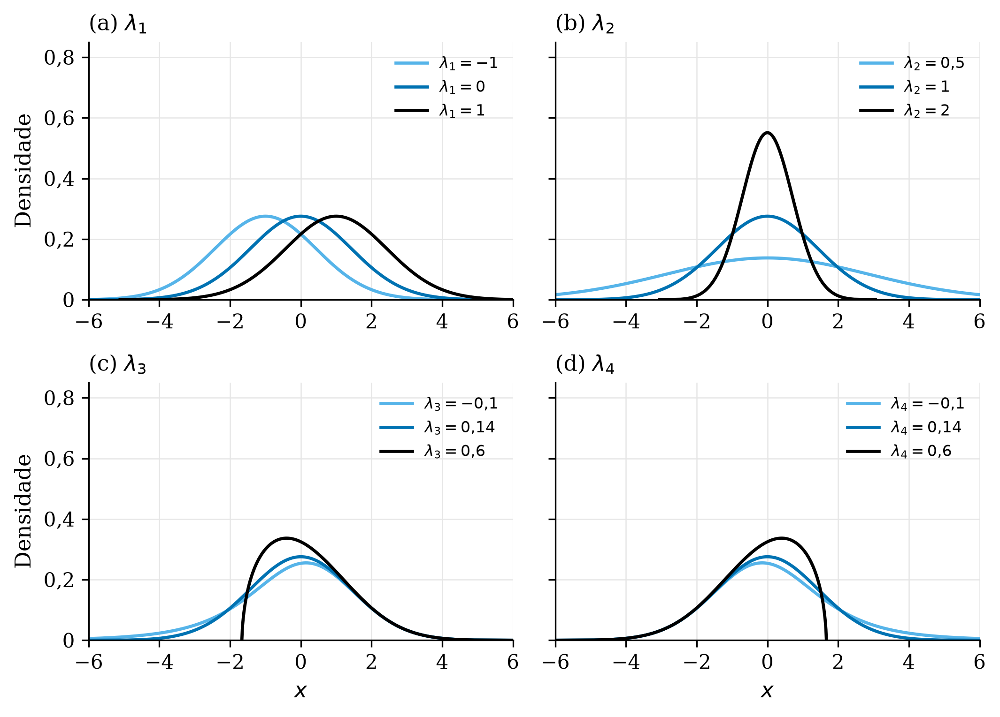

.. _`sec:gld`:

A distribuição lambda generalizada
==================================

Da densidade à função quantil
-----------------------------

Uma variável aleatória contínua :math:`X` costuma ser apresentada aos estudantes pela sua função distribuição acumulada (FDA),

.. math::

   F(x) = P(X \leq x),

e pela sua função densidade de probabilidade (FDP), :math:`f(x) = F'(x)`, cuja integral em um intervalo fornece a probabilidade de observar um valor nele, :math:`P(a < X \leq b) = \int_a^b f(x)\,dx`. Uma terceira descrição, equivalente e menos explorada no ensino, é a função quantil :ref:`[7] <ref-gilchrist2000>`,

.. _eq:quantil:

.. math::

   Q(u) = F^{-1}(u), \qquad 0 < u < 1,
   \tag{2}

que responde à pergunta inversa, isto é, qual é o valor :math:`x` abaixo do qual se encontra uma fração :math:`u` das observações. Quando :math:`F` não é estritamente crescente, :math:`Q(u)` é definida como o menor :math:`x` tal que :math:`F(x) \geq u`. A leitura é direta e se faz nas unidades da grandeza, pois :math:`Q(0{,}5)` é a mediana e :math:`Q(0{,}95)` é o valor superado em apenas :math:`5\%` das ocorrências.

Para uma distribuição contínua e estritamente crescente no seu suporte, vale :math:`F(Q(u)) = u`. Derivando os dois lados em relação a :math:`u`, obtém-se :math:`f(Q(u))\,Q'(u) = 1`, isto é,

.. _eq:densidade_quantil:

.. math::

   f(Q(u)) = \frac{1}{Q'(u)},
   \tag{3}

de modo que a densidade pode ser desenhada parametricamente, tomando :math:`x = Q(u)` e :math:`f = 1/Q'(u)` para uma grade de valores de :math:`u`, sem que seja preciso inverter a função quantil.

Uma expressão explícita para :math:`Q` tem uma segunda vantagem, que é a facilidade de gerar amostras. Se :math:`U` é uniforme em :math:`(0,1)`, então :math:`X = Q(U)` tem distribuição :math:`F`, pois :math:`P(Q(U) \leq x) = P(U \leq F(x)) = F(x)`. Esse é o método da transformação inversa. Nos estudos de caso deste artigo, porém, o ponto de partida são sempre dados observados.

O Código :ref:`1 <lst:quantil>` mostra essas duas operações com a biblioteca ``pyglam`` :ref:`[15] <ref-pyglam>`, usada ao longo do artigo. A função quantil é avaliada pelo método ``ppf``, e a amostragem pela transformação inversa, pelo método ``rvs``.

.. _lst:quantil:

**Código 1. Quantis e amostragem de uma GLD-FKML com a biblioteca ``pyglam``.**

.. code-block:: python

   import numpy as np
   from pyglam import GlamFKML

   # GLD-FKML com lambda = (0; 1; 0,14; 0,14), forma próxima da normal
   modelo = GlamFKML(0.0, 1.0, 0.14, 0.14)

   # quantis lidos diretamente da função quantil Q(u)
   mediana, p95 = modelo.ppf([0.50, 0.95])

   # amostragem pela transformação inversa, X = Q(U)
   amostra = modelo.rvs(size=1000, random_state=42)

A formulação FKML e o significado dos parâmetros
------------------------------------------------

A distribuição lambda generalizada, na parametrização de Freimer e colaboradores :ref:`[10] <ref-freimer1988>`, é definida pela função quantil

.. _eq:fkml:

.. math::

   Q(u) = \lambda_1 + \frac{1}{\lambda_2}
       \left[\frac{u^{\lambda_3} - 1}{\lambda_3} - \frac{(1-u)^{\lambda_4} - 1}{\lambda_4}\right],
       \qquad 0 < u < 1, \quad \lambda_2 > 0,
   \tag{4}

em que, para :math:`\lambda_3 = 0` ou :math:`\lambda_4 = 0`, cada fração é substituída pelo seu limite, :math:`\lim_{a \to 0} (u^a - 1)/a = \ln u`.

O papel de cada parâmetro está resumido na Tabela :ref:`2 <tab:parametros>` e ilustrado na Figura :ref:`1 <fig:parametros>`, em que um parâmetro varia por vez e os demais ficam fixos. O parâmetro :math:`\lambda_1` desloca a distribuição sem alterar sua forma. O parâmetro :math:`\lambda_2` controla inversamente a escala, de modo que dobrá-lo reduz a dispersão pela metade. Os parâmetros :math:`\lambda_3` e :math:`\lambda_4` controlam a forma, atuando principalmente sobre o lado esquerdo e o lado direito da distribuição, respectivamente. Valores positivos tornam a cauda correspondente limitada. O valor zero produz uma cauda ilimitada de decaimento exponencial, e valores negativos, uma cauda ilimitada e mais pesada, de decaimento em lei de potência. Se :math:`X` tem unidade física, :math:`\lambda_1` tem essa unidade, :math:`\lambda_2` tem a unidade inversa e os parâmetros de forma são adimensionais.

.. _tab:parametros:

.. container::

   .. table:: Tabela 2. Interpretação didática dos parâmetros da GLD-FKML.

      +--------------------------------------+--------------------------------------------------------------------------------+----------------------------------------------------------------------------------+
      | **Parâmetro**                        | **Interpretação**                                                              | **Cuidado**                                                                      |
      +======================================+================================================================================+==================================================================================+
      | :math:`\lambda_1`                    | Desloca a distribuição                                                         | Não é, em geral, a média nem a mediana                                           |
      +--------------------------------------+--------------------------------------------------------------------------------+----------------------------------------------------------------------------------+
      | :math:`\lambda_2`                    | Controla inversamente a escala                                                 | Não é o desvio padrão. Aumentá-lo, com os demais fixos, reduz a dispersão        |
      +--------------------------------------+--------------------------------------------------------------------------------+----------------------------------------------------------------------------------+
      | :math:`\lambda_3`, :math:`\lambda_4` | Controlam conjuntamente a forma, com efeitos sobre os lados esquerdo e direito | Não identificar um deles exclusivamente com a assimetria e o outro com a curtose |
      +--------------------------------------+--------------------------------------------------------------------------------+----------------------------------------------------------------------------------+

.. _fig:parametros:

   Figura 1. Densidades da GLD-FKML variando um parâmetro por vez, a partir de :math:`\boldsymbol\lambda = (0;\, 1;\, 0{,}14;\, 0{,}14)`, uma forma próxima da normal, com (a) o deslocamento por :math:`\lambda_1`, (b) a escala por :math:`\lambda_2`, (c) o lado esquerdo por :math:`\lambda_3` e (d) o lado direito por :math:`\lambda_4`.

Validade, suporte e momentos
----------------------------

Nem todo conjunto de parâmetros define uma distribuição, pois é preciso que a função quantil seja crescente. Derivando a equação :ref:`(4) <eq:fkml>`,

.. _eq:qlinha:

.. math::

   Q'(u) = \frac{u^{\lambda_3 - 1} + (1-u)^{\lambda_4 - 1}}{\lambda_2},
   \tag{5}

cujo numerador é positivo para quaisquer :math:`\lambda_3` e :math:`\lambda_4` reais. Na parametrização FKML, portanto, :math:`\lambda_2 > 0` basta para que a distribuição seja válida.

O suporte, isto é, o intervalo de valores possíveis, vai de :math:`a = Q(0^+)` a :math:`b = Q(1^-)`, dados por

.. _eq:suporte:

.. math::

   a = \begin{cases}
           \lambda_1 - \dfrac{1}{\lambda_2 \lambda_3}, & \lambda_3 > 0, \\[6pt]
           -\infty, & \lambda_3 \leq 0,
       \end{cases}
       \qquad
       b = \begin{cases}
           \lambda_1 + \dfrac{1}{\lambda_2 \lambda_4}, & \lambda_4 > 0, \\[6pt]
           +\infty, & \lambda_4 \leq 0.
       \end{cases}
   \tag{6}

Aqui aparece a primeira ponte com a física. Uma distribuição matematicamente válida pode atribuir probabilidade a valores fisicamente impossíveis, como velocidades negativas, ou excluir valores que foram de fato observados. Por isso, o suporte é examinado depois de cada ajuste neste artigo.

Validade e existência de momentos são propriedades distintas. O momento de ordem :math:`k` existe quando :math:`\lambda_3, \lambda_4 > -1/k`. O ajuste pelos quatro primeiros momentos exige, portanto, :math:`\lambda_3, \lambda_4 > -1/4`.

O método dos momentos, passo a passo
------------------------------------

A ideia do método dos momentos, proposto para a família lambda generalizada por Ramberg e colaboradores :ref:`[9] <ref-ramberg1979>`, é escolher os parâmetros de modo que as características resumidas do modelo coincidam com as da amostra. Para observações :math:`x_1, \ldots, x_n`, definem-se

.. _eq:momentos_amostra:

.. math::

   \bar x = \frac{1}{n}\sum_{i=1}^{n} x_i, \qquad
       m_k = \frac{1}{n}\sum_{i=1}^{n} (x_i - \bar x)^k, \qquad
       \widehat\gamma_1 = \frac{m_3}{m_2^{3/2}}, \qquad
       \widehat\beta_2 = \frac{m_4}{m_2^{2}},
   \tag{7}

isto é, a média, a variância (com divisor :math:`n`), a assimetria e a curtose. A curtose de Pearson, :math:`\widehat\beta_2`, vale :math:`3` para a normal e mede o peso das observações afastadas do centro. Ela não deve ser lida simplesmente como a altura do pico. O ajuste procura parâmetros :math:`\boldsymbol\lambda` que satisfaçam

.. _eq:sistema:

.. math::

   \mu(\boldsymbol\lambda) = \bar x, \qquad
       \sigma^2(\boldsymbol\lambda) = m_2, \qquad
       \gamma_1(\boldsymbol\lambda) = \widehat\gamma_1, \qquad
       \beta_2(\boldsymbol\lambda) = \widehat\beta_2.
   \tag{8}

Os momentos do modelo decorrem diretamente da função quantil. Como :math:`X = Q(U)`, com :math:`U` uniforme,

.. math::

   E[X^r] = \int_0^1 Q(u)^r \, du,

e, para a média, basta integrar a equação :ref:`(4) <eq:fkml>` termo a termo, usando :math:`\int_0^1 (u^{\lambda} - 1)/\lambda \, du = -1/(\lambda + 1)`, o que resulta em

.. _eq:media:

.. math::

   E[X] = \lambda_1 + \frac{1}{\lambda_2}
       \left[\frac{1}{1 + \lambda_4} - \frac{1}{1 + \lambda_3}\right].
   \tag{10}

Os momentos de ordem superior seguem o mesmo caminho e resultam em combinações de funções beta dos parâmetros de forma :ref:`[10] <ref-freimer1988>`, :ref:`[11] <ref-karian2011>`. O notebook que acompanha o artigo os avalia numericamente.

O sistema da equação :ref:`(8) <eq:sistema>` é não linear e é resolvido numericamente. O roteiro do ajuste tem cinco passos.

#. Calcular os quatro resumos amostrais da equação :ref:`(7) <eq:momentos_amostra>`.

#. Propor parâmetros iniciais.

#. Calcular os momentos do modelo e as discrepâncias em relação aos da amostra.

#. Atualizar os parâmetros até que as discrepâncias se anulem.

#. Verificar a validade, o domínio dos momentos, o suporte e a aderência aos dados.

Na biblioteca ``pyglam`` :ref:`[15] <ref-pyglam>`, a função ``fit_lambdas`` executa os passos 2 a 4 minimizando por mínimos quadrados os resíduos escalonados das quatro relações, a partir de vários pontos iniciais. Neste artigo, usaram-se :math:`15` pontos, o primeiro construído a partir da média e do desvio padrão amostrais e os demais tomados de uma grade fixa que cobre formas limitadas, próximas da exponencial e de caudas pesadas. Entre as soluções obtidas, a biblioteca dá preferência às que definem uma distribuição válida e estão no domínio dos momentos, escolhe a de menor resíduo e, quando vários resíduos são numericamente equivalentes, desempata pela menor distância entre os quantis do modelo e os da amostra. Todas as tentativas ficam registradas no resultado do ajuste, o que permite ao estudante inspecionar a não unicidade discutida a seguir. O último passo cabe ao usuário, e é nele que os estudos de caso se concentram.

O que o ajuste por momentos garante e o que precisa ser avaliado
----------------------------------------------------------------

Reproduzir os quatro momentos da amostra não identifica uma única distribuição, já que, mesmo dentro da família FKML, parâmetros diferentes podem ter os mesmos quatro momentos :ref:`[11] <ref-karian2011>`. Além disso, os momentos de ordem alta são sensíveis a poucos valores extremos, e o sucesso numérico do otimizador não informa se o modelo representa bem os dados. Por isso, conferir os momentos e avaliar a aderência são etapas complementares. A flexibilidade da família, por sua vez, não se confunde com a capacidade de um estimador específico, pois um resultado desfavorável obtido pelo método dos momentos não demonstra que nenhuma GLD descreveria os dados. Existem estimadores alternativos, como o método dos percentis, o dos L-momentos e o de máxima verossimilhança :ref:`[11] <ref-karian2011>`, :ref:`[18] <ref-su2007>`. Este último, por construção, só aceita parâmetros cujo suporte contenha todas as observações, uma propriedade que o método dos momentos não garante e cuja importância ficará clara no estudo de caso do vento.
