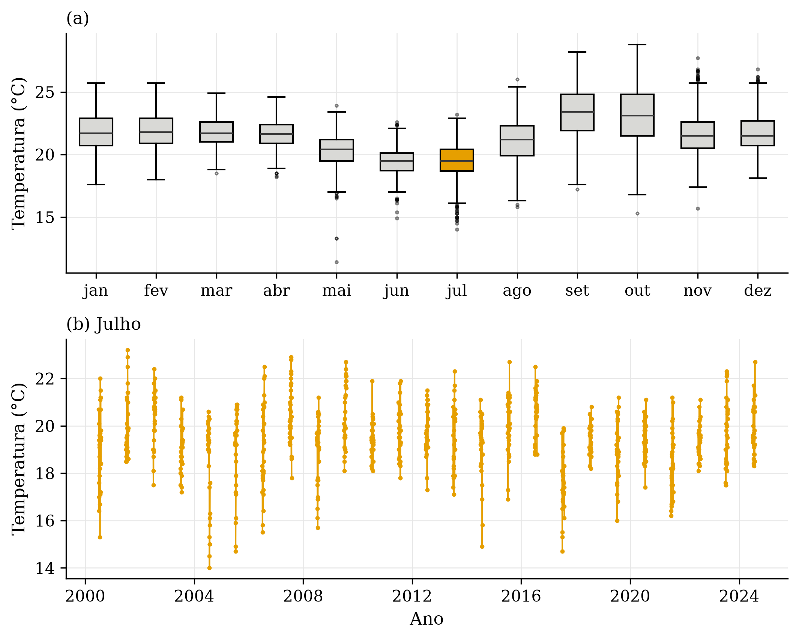
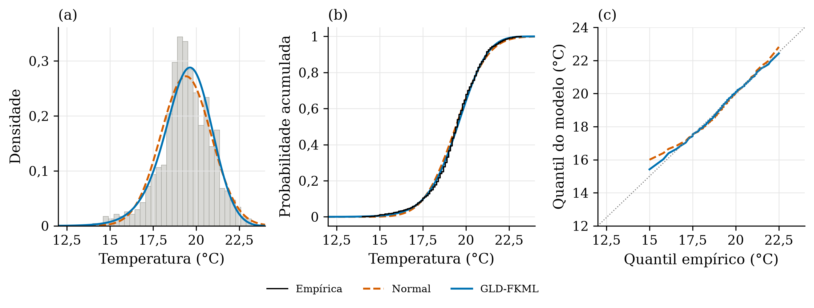

.. _`sec:temperatura`:

Ajuste e interpretação de dados de temperatura
==============================================

Por que esta grandeza?
----------------------

A temperatura do ar é uma das grandezas termodinâmicas mais familiares no cotidiano e na experimentação científica elementar.

Frequentemente, em cursos introdutórios de física e engenharia, assume-se como premissa tácita que grandezas contínuas se comportam de forma gaussiana. Contudo, a grandeza física “temperatura” não determina, por si só, uma distribuição normal. A série agregada ao longo de vários anos incorpora fortes efeitos sazonais e transições de massas de ar que geram a sobreposição de populações com médias e variâncias distintas.

Este segundo exemplo complementa o do vento. Enquanto no vento investigou-se a restrição de suporte e a assimetria positiva, na temperatura examina-se até que ponto uma distribuição aproximadamente simétrica justifica o abandono da distribuição normal em favor de uma família flexível de quatro parâmetros.

Definição do recorte temporal
-----------------------------

A análise da série plurianual completa revela uma variação sazonal evidente, que inviabiliza um modelo único para todo o ano sem estratificação. Para manter um recorte físico e temporal mais homogêneo, selecionou-se a temperatura média diária do mês de julho. O recorte contempla :math:`768` observações diárias válidas, distribuídas ao longo de 25 invernos (2000 a 2024).

A escolha de julho foi estabelecida *a priori*, com base em um critério climatológico (o auge do inverno no Centro-Oeste brasileiro), e não por meio de uma varredura exploratória em busca do mês com maior aderência à normal ou à GLD. A restrição ao calendário atenua a heterogeneidade entre estações do ano, embora não elimine a dependência entre dias adjacentes nem a variabilidade interanual. O modelo ajustado deve ser interpretado como a caracterização probabilística das temperaturas médias diárias observadas em julho naquela estação meteorológica.

A Figura :ref:`4 <fig:temp_sazonalidade>` ilustra o ciclo anual da temperatura na estação por meio da distribuição mensal e destaca a série do mês de julho. O painel (b) mostra também que alguns invernos, como os de 2004 e 2017, tiveram dias bem mais frios que os demais.

.. _fig:temp_sazonalidade:

   Figura 4. Temperatura média diária na estação A001, com (a) a distribuição por mês, destacando julho, e (b) a série das temperaturas de julho, de 2000 a 2024.

Desempenho das distribuições e interpretações
---------------------------------------------

A amostra de julho (Tabela :ref:`7 <tab:descritiva_temperatura>`) apresenta temperatura média de :math:`19,409\,^\circ\text{C}`, desvio padrão de :math:`1,466\,^\circ\text{C}` (com divisor :math:`n`), assimetria moderadamente negativa (:math:`-0,482`) e curtose de Pearson de :math:`3,717`, isto é, um excesso de :math:`0,717` em relação à normal. Os quantis empíricos de 5%, 50% e 95% são :math:`16,84\,^\circ\text{C}`, :math:`19,50\,^\circ\text{C}` e :math:`21,70\,^\circ\text{C}`, respectivamente.

.. _tab:descritiva_temperatura:

.. container::

   .. table:: Tabela 7. Estatísticas descritivas da temperatura média diária de julho. Desvio padrão com divisor :math:`n` e curtose de Pearson (igual a :math:`3` para a normal).

      +------------------------------------------------------------+----------------------------------------------+
      | **Estatística**                                            | **Temperatura em julho (:math:`^\circ`\ C)** |
      +============================================================+==============================================+
      | :math:`n`                                                  | 768                                          |
      +------------------------------------------------------------+----------------------------------------------+
      | Média                                                      | 19,409                                       |
      +------------------------------------------------------------+----------------------------------------------+
      | Mediana                                                    | 19,50                                        |
      +------------------------------------------------------------+----------------------------------------------+
      | Desvio padrão                                              | 1,466                                        |
      +------------------------------------------------------------+----------------------------------------------+
      | Assimetria                                                 | :math:`-0{,}482`                             |
      +------------------------------------------------------------+----------------------------------------------+
      | Curtose (Pearson)                                          | 3,717                                        |
      +------------------------------------------------------------+----------------------------------------------+
      | Mínimo; máximo                                             | 14,0; 23,2                                   |
      +------------------------------------------------------------+----------------------------------------------+
      | :math:`Q_{0{,}05}`; :math:`Q_{0{,}50}`; :math:`Q_{0{,}95}` | 16,84; 19,50; 21,70                          |
      +------------------------------------------------------------+----------------------------------------------+

Aplicando o mesmo protocolo da seção :ref:`4 <sec:vento>`, comparou-se o modelo normal, com parâmetros de máxima verossimilhança :math:`\widehat{\mu} = 19,409\,^\circ\text{C}` e :math:`\widehat{\sigma} = 1,466\,^\circ\text{C}`, com a GLD-FKML ajustada pelo método dos momentos com a biblioteca ``pyglam``, que resultou em :math:`\widehat{\boldsymbol\lambda} = (19,538;\, 1,0707;\, 0,0175;\, 0,1836)`.

As discrepâncias quantílicas são reportadas diretamente na unidade física (:math:`\Delta_p`, em :math:`^\circ`\ C). A Tabela :ref:`8 <tab:desempenho_temperatura>` apresenta os diagnósticos comparativos e a Figura :ref:`5 <fig:diagnosticos_temperatura>` sintetiza a sobreposição das densidades, as funções acumuladas e o gráfico Q-Q.

.. _tab:desempenho_temperatura:

.. container::

   .. table:: Tabela 8. Desempenho dos modelos ajustados às temperaturas médias diárias de julho. As diferenças de quantis :math:`\Delta_p` estão em :math:`^\circ`\ C.

      +------------+----------------+-----------------+---------------------------+---------------------------+---------------------------+
      | **Modelo** | **Parâmetros** | **:math:`D_n`** | **:math:`\Delta_{0,05}`** | **:math:`\Delta_{0,50}`** | **:math:`\Delta_{0,95}`** |
      +============+================+=================+===========================+===========================+===========================+
      | Normal     | 2              | 0,064           | +0,163                    | -0,091                    | +0,120                    |
      +------------+----------------+-----------------+---------------------------+---------------------------+---------------------------+
      | GLD-FKML   | 4              | 0,041           | +0,025                    | +0,002                    | -0,058                    |
      +------------+----------------+-----------------+---------------------------+---------------------------+---------------------------+

.. _fig:diagnosticos_temperatura:

   Figura 5. Diagnóstico comparativo das temperaturas de julho, com (a) densidades sobrepostas ao histograma, (b) funções distribuição acumuladas e (c) gráfico quantil-quantil, em que a linha pontilhada indica concordância perfeita. Como na Figura :ref:`3 <fig:diagnosticos>`, o gráfico Q-Q usa os percentis de 1% a 99%.

Interpretação didática e física
-------------------------------

Neste exemplo, a escolha entre a normal e a GLD-FKML recorre ao princípio da parcimônia (navalha de Ockham). A distribuição normal ajustada exibe uma distância de Kolmogorov-Smirnov pequena (:math:`D_n = 0,064`), e os desvios quantílicos situam-se na ordem de décimos de grau Celsius (:math:`+0,16\,^\circ\text{C}` no quantil de 5% e :math:`+0,12\,^\circ\text{C}` no de 95%).

Para decidir se essas discrepâncias justificam um modelo mais complexo, a escala usada aqui é a incerteza amostral dos próprios quantis empíricos. A incerteza do sensor não foi incluída, porque a série não traz metadados instrumentais suficientes para estimá-la. Simulando amostras independentes de :math:`768` valores a partir da GLD ajustada, o desvio padrão do quantil empírico de :math:`5\%` é de cerca de :math:`0{,}15\,^\circ\text{C}`, e o do quantil de :math:`95\%`, de cerca de :math:`0{,}09\,^\circ\text{C}`. Temperaturas de dias consecutivos, porém, são fortemente correlacionadas (coeficiente de autocorrelação de :math:`0{,}65`), e julhos de anos diferentes podem ser sistematicamente mais frios ou mais quentes, de modo que a amostra contém menos informação independente do que sugerem os :math:`768` valores. Reamostrando anos inteiros por *bootstrap* (Código :ref:`5 <lst:bootstrap_anos>`), o que preserva essas duas fontes de dependência, os desvios padrão dos quantis de :math:`5\%`, :math:`50\%` e :math:`95\%` passam a :math:`0{,}38`, :math:`0{,}10` e :math:`0{,}21\,^\circ\text{C}`. As discrepâncias da normal (:math:`+0{,}16`, :math:`-0{,}09` e :math:`+0{,}12\,^\circ\text{C}`) são menores que esses desvios padrão. A comparação é descritiva, e não um teste, mas mostra que, nos três quantis examinados, a normal erra menos do que os próprios quantis variam de uma reamostra para outra. Já o valor de :math:`D_n` da normal, cerca do dobro do valor crítico de :math:`5\%` do teste de Lilliefors para observações independentes (:math:`0{,}886/\sqrt{n} \approx 0{,}032`) :ref:`[22] <ref-lilliefors1967>`, sugere uma diferença de forma, mas a dependência entre dias torna esse valor crítico otimista, e o resultado não é conclusivo. Nesses casos, mesmo que a GLD-FKML acomode a assimetria negativa e reduza :math:`D_n` para :math:`0{,}041`, com desvios quantílicos abaixo de :math:`0{,}06\,^\circ\text{C}`, o acréscimo de dois parâmetros livres exige julgamento crítico, pois, para muitas aplicações térmicas usuais, o modelo normal de dois parâmetros oferece uma descrição simples e suficiente.

.. _lst:bootstrap_anos:

**Código 5. Incerteza dos quantis empíricos das temperaturas de julho por *bootstrap* de anos inteiros.**

.. code-block:: python

   # um vetor de temperaturas para cada julho (cada ano é um bloco)
   dados["data"] = pd.to_datetime(dados["data"])
   julho = dados[(dados["data"].dt.month == 7) & dados["temperatura_c"].notna()]
   anos = [g["temperatura_c"].to_numpy() for _, g in julho.groupby(julho["data"].dt.year)]

   rng = np.random.default_rng(0)
   p = [0.05, 0.50, 0.95]
   Q = []
   for _ in range(1000):
       sorteio = rng.integers(0, len(anos), len(anos))        # anos sorteados com reposição
       amostra = np.concatenate([anos[i] for i in sorteio])   # reúne os julhos sorteados
       Q.append(np.quantile(amostra, p))

   print(np.std(Q, axis=0))     # desvio padrão dos quantis empíricos entre reamostras

O suporte da GLD ajustada reforça essa leitura. Com :math:`\lambda_3` e :math:`\lambda_4` positivos, o modelo é limitado nos dois lados, entre :math:`-33,9\,^\circ\text{C}` e :math:`24,6\,^\circ\text{C}` (calculados com os parâmetros sem arredondamento, disponíveis no material suplementar, e com os valores impressos acima obtém-se :math:`-33,8\,^\circ\text{C}`). O limite inferior é muito sensível a :math:`\lambda_3`, pois, com :math:`\lambda_3 = 0,018`, por exemplo, ele passaria a cerca de :math:`-32,3\,^\circ\text{C}`, o que já mostra que esse número não tem significado físico. O limite superior é plausível, pouco acima do máximo observado de :math:`23,2\,^\circ\text{C}`. O inferior é fisicamente implausível para Brasília em julho, embora o modelo atribua a essa região uma probabilidade desprezível, porque :math:`\lambda_3` muito pequeno produz uma cauda esquerda longa e extremamente fina. Os limites do suporte, portanto, são uma consequência matemática dos parâmetros, e não devem ser lidos como limites físicos da grandeza.

Por outro lado, caso o foco resida na estimativa de eventos de frio intenso (cauda esquerda), a assimetria negativa capturada pela GLD ganha relevância. Uma explicação física plausível é a passagem ocasional de frentes frias e as incursões de ar frio de origem polar, que no inverno alcançam o Brasil Central :ref:`[25] <ref-garreaud2000>` e podem produzir dias isolados bem mais frios que a média, sem um mecanismo de mesma intensidade do lado quente. Este trabalho não associou os dias frios da amostra a eventos específicos. A explicação é, portanto, uma hipótese compatível com a assimetria observada. Os quantis estimados descrevem a variabilidade das temperaturas médias diárias no histórico observado do mês, mas não representam intervalos de confiança da média amostral, nem limites do sensor, tampouco uma previsão para um dia específico.
