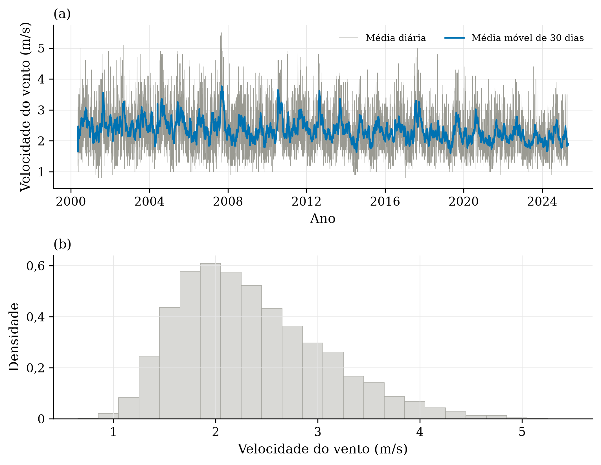
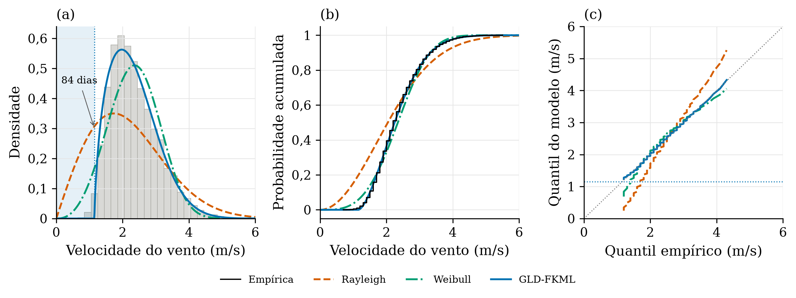

.. _`sec:vento`:

Ajuste de distribuições e interpretação de dados de vento
=========================================================

Apresentação breve da biblioteca e do ambiente
----------------------------------------------

Para a condução deste estudo de caso e a reprodução dos ajustes propostos, emprega-se a biblioteca ``pyglam`` (versão 1.1.0) :ref:`[15] <ref-pyglam>`, desenvolvida em Python e disponibilizada publicamente, e as distribuições clássicas da biblioteca ``scipy.stats`` :ref:`[16] <ref-scipy2020>`. O pacote implementa a parametrização FKML da família lambda generalizada e o seu ajuste pelo método dos momentos, descrito na seção :ref:`2 <sec:gld>`.

Neste estudo, são utilizados os seguintes recursos da biblioteca ``pyglam``: ``GlamFKML``, para a instanciação do modelo paramétrico, ``fit_lambdas``, para a execução do algoritmo de ajuste, e os métodos ``pdf`` (função densidade de probabilidade), ``cdf`` (função distribuição acumulada) e ``ppf`` (função quantil, do inglês *percent point function*). O método ``rvs`` permite a geração de amostras aleatórias via transformação inversa. A função de ajuste retorna a solução do otimizador (``sol.x``), e o usuário instancia explicitamente o modelo ajustado (``modelo = GlamFKML(*sol.x)``), em vez de alterar a instância original.

Origem, unidade e qualidade dos dados
-------------------------------------

Os dados empíricos utilizados neste estudo são as velocidades médias diárias do vento (em m/s) da estação meteorológica automática A001 do Instituto Nacional de Meteorologia (INMET), em Brasília (DF), obtidas do Banco de Dados Meteorológicos do INMET :ref:`[24] <ref-inmet2025>`. A estação, de código OMM 86715, situa-se a cerca de :math:`15{,}79^\circ` S e :math:`47{,}93^\circ` W, a :math:`1.161` m de altitude, e opera desde maio de 2000. Foi a primeira estação automática da rede do INMET. O arquivo compreende o período de 06/05/2000 a 25/04/2025, com 9.121 registros diários sem datas repetidas, dos quais 8.840 contêm a velocidade do vento e 281 estão vazios. Não há registros nulos ou negativos, e os valores aparecem no arquivo com passo de :math:`0,1\,\text{m/s}`. Esse é o passo de registro (arredondamento) dos dados, que não deve ser confundido com a resolução metrológica do anemômetro, não documentada no arquivo.

Os valores diários foram usados como fornecidos pelo INMET, sem recálculo das médias. Há 101 interrupções entre registros válidos, a maior com 29 dias. Como todo o período é analisado em conjunto, o alvo aqui é a distribuição histórica agregada das médias diárias, que mistura as estações do ano, e não a de uma estação específica. A média mensal varia de cerca de :math:`2,10` a :math:`2,75\,\text{m/s}` ao longo do ano.

As velocidades diárias válidas variam entre o mínimo de :math:`0,7\,\text{m/s}` e o máximo de :math:`5,5\,\text{m/s}`, com média amostral de :math:`2,345\,\text{m/s}` e desvio padrão de :math:`0,711\,\text{m/s}` (calculado com divisor :math:`n`).

Caracterização exploratória
---------------------------

Ao analisar os dados, verifica-se que a velocidade média diária do vento apresenta assimetria positiva, limitando-se inferiormente pelo zero físico e estendendo-se em uma cauda direita que acomoda dias excepcionalmente ventosos.

A Figura :ref:`2 <fig:exploratoria>` mostra a série temporal e o histograma, evidenciando a concentração da massa de probabilidade na faixa de :math:`1,5` a :math:`3,0\,\text{m/s}`. A Tabela :ref:`4 <tab:descritiva_vento>` reúne as estatísticas descritivas, incluindo os quantis de 5%, 50% e 95%, que servirão de referência numérica para avaliar as curvas ajustadas.

.. _fig:exploratoria:

   Figura 2. Velocidade média diária do vento na estação automática A001, em Brasília (DF), com (a) a série temporal e a média móvel de 30 dias e (b) o histograma.

.. _tab:descritiva_vento:

.. container::

   .. table:: Tabela 4. Estatísticas descritivas da velocidade média diária do vento. Desvio padrão com divisor :math:`n` e curtose de Pearson (igual a :math:`3` para a normal).

      +------------------------------------------------------------+------------------+
      | **Estatística**                                            | **Vento (m/s)**  |
      +============================================================+==================+
      | :math:`n`                                                  | 8.840            |
      +------------------------------------------------------------+------------------+
      | Média                                                      | 2,345            |
      +------------------------------------------------------------+------------------+
      | Mediana                                                    | 2,20             |
      +------------------------------------------------------------+------------------+
      | Desvio padrão                                              | 0,711            |
      +------------------------------------------------------------+------------------+
      | Coeficiente de variação                                    | 0,303            |
      +------------------------------------------------------------+------------------+
      | Assimetria                                                 | 0,738            |
      +------------------------------------------------------------+------------------+
      | Curtose (Pearson)                                          | 3,368            |
      +------------------------------------------------------------+------------------+
      | Mínimo; máximo                                             | 0,7; 5,5         |
      +------------------------------------------------------------+------------------+
      | :math:`Q_{0{,}05}`; :math:`Q_{0{,}50}`; :math:`Q_{0{,}95}` | 1,40; 2,20; 3,70 |
      +------------------------------------------------------------+------------------+

Famílias comparadas e estimação
-------------------------------

O ajuste estatístico compara três modelos paramétricos, a GLD-FKML e dois modelos clássicos de referência com origem fixada no zero físico, a distribuição de Rayleigh (um parâmetro) e a distribuição de Weibull (dois parâmetros), ambas ajustadas por máxima verossimilhança.

A adoção da distribuição de Rayleigh no escopo atmosférico assume as hipóteses da seção :ref:`3 <sec:dados>` (componentes de vento gaussianas, ortogonais e independentes), formuladas para velocidades em intervalos curtos. Ao aplicá-la a médias diárias, testa-se deliberadamente um modelo fora do seu domínio de validade, o que ilustra a importância da definição da variável. O estimador de máxima verossimilhança para esta família é :math:`\widehat\sigma = \sqrt{\sum_{i=1}^n v_i^2 / (2n)}`, que fornece :math:`\widehat\sigma = 1,733\,\text{m/s}`. No entanto, uma limitação estrutural surge imediatamente dos dados, pois o coeficiente de variação (CV) da distribuição de Rayleigh com origem em zero é uma constante, :math:`\sqrt{(4-\pi)/\pi} \approx 0,523`, independentemente de :math:`\sigma`. Em contrapartida, o CV empírico da amostra diária analisada é de :math:`0,303`. Esta discrepância impede que o modelo de Rayleigh se adapte à forma da distribuição dos dados observados, qualquer que seja sua escala. Parte dela é esperada, porque a média de um dia combina dezenas de leituras e, por isso, varia relativamente menos de um dia para outro do que a velocidade em uma hora.

A introdução do modelo de Weibull flexibiliza essa restrição ao incorporar um parâmetro de forma (sendo a Rayleigh seu caso particular quando esse parâmetro vale :math:`2`). O ajuste fornece forma :math:`\widehat k = 3,448` e escala :math:`\widehat c = 2,605\,\text{m/s}`, o que oferece uma base de comparação mais justa com a flexibilidade dos quatro parâmetros da GLD-FKML.

A solução obtida para a GLD-FKML, :math:`\widehat{\boldsymbol\lambda} = (2,191;\, 1,727;\, 0,555;\, 0,099)`, reproduz os quatro momentos da amostra. Como :math:`\lambda_3` e :math:`\lambda_4` são positivos, a equação :ref:`(6) <eq:suporte>` indica que o modelo ajustado tem suporte limitado, de :math:`1,148` a :math:`8,057\,\text{m/s}`, enquanto os dados observados variam de :math:`0,7` a :math:`5,5\,\text{m/s}`. A consequência desse resultado é discutida na seção :ref:`4.6 <subsec:vento_interpretacao>`.

O Código :ref:`2 <lst:ajuste>`, que continua o Código :ref:`1 <lst:quantil>`, executa esse ajuste, calcula os limites do suporte pela equação :ref:`(6) <eq:suporte>` e conta as observações que ficam fora dele.

.. _lst:ajuste:

**Código 2. Ajuste da GLD-FKML aos dados de vento pelo método dos momentos e verificação do suporte.**

.. code-block:: python

   import pandas as pd

   dados = pd.read_csv("estacao_A001_diario.csv")
   v = dados["vento_ms"].dropna().to_numpy()      # velocidades médias diárias (m/s)

   # método dos momentos a partir de 15 pontos iniciais
   sol = GlamFKML().fit_lambdas(v, n_starts=15, seed=0)
   gld = GlamFKML(*sol.x)                         # modelo ajustado
   l1, l2, l3, l4 = sol.x

   # limites do suporte, como na equação do suporte
   a = l1 - 1 / (l2 * l3) if l3 > 0 else -np.inf
   b = l1 + 1 / (l2 * l4) if l4 > 0 else np.inf
   fora = np.sum((v < a) | (v > b))               # observações fora do suporte

Desempenho das distribuições e interpretações
---------------------------------------------

A qualidade do ajuste é avaliada por duas medidas. A primeira é adimensional e a segunda é expressa na unidade da grandeza (m/s), o que permite interpretar fisicamente as discrepâncias.

#. **Aderência global:** distância de Kolmogorov-Smirnov, :math:`D_n = \sup_v |F_n(v) - \widehat{F}(v)|`, que quantifica o maior desvio absoluto entre a acumulada empírica e a do modelo.

#. **Desvios nas caudas e no centro:** diferenças quantílicas :math:`\Delta_p` da equação :ref:`(14) <eq:delta>`, nos percentis :math:`p \in \{0,05;\, 0,50;\, 0,95\}`. O sinal de :math:`\Delta_p` indica imediatamente se o modelo subestima (negativo) ou superestima (positivo) o vento, em m/s.

O Código :ref:`3 <lst:avaliacao>` calcula as duas métricas para a GLD ajustada no Código :ref:`2 <lst:ajuste>`. Para os modelos de Rayleigh e de Weibull, basta trocar ``gld`` pela distribuição correspondente da biblioteca ``scipy.stats``, que oferece os mesmos métodos ``ppf`` e ``cdf``.

.. _lst:avaliacao:

**Código 3. Desvios quantílicos e distância de Kolmogorov-Smirnov do modelo ajustado.**

.. code-block:: python

   # desvios quantílicos, em m/s
   p = np.array([0.05, 0.50, 0.95])
   delta = gld.ppf(p) - np.quantile(v, p)

   # distância de Kolmogorov-Smirnov entre a acumulada empírica e a do modelo
   x = np.sort(v)
   n = x.size
   F = gld.cdf(x)
   i = np.arange(1, n + 1)
   Dn = max(np.max(i / n - F), np.max(F - (i - 1) / n))

A Tabela :ref:`5 <tab:desempenho_vento>` compila estas métricas. A Figura :ref:`3 <fig:diagnosticos>` reúne a densidade, a função acumulada e o gráfico Q-Q, permitindo localizar em quais quantis cada modelo se afasta dos dados. Em (a) e em (c), a faixa sombreada e a linha horizontal marcam o limite inferior do suporte da GLD (:math:`1,148\,\text{m/s}`), abaixo do qual há :math:`84` dias da amostra, cuja importância é discutida na seção :ref:`4.6 <subsec:vento_interpretacao>`. Como o gráfico Q-Q usa os percentis de 1% a 99% e esses dias correspondem a :math:`0,95\%` da amostra, eles não aparecem nele.

.. _tab:desempenho_vento:

.. container::

   .. table:: Tabela 5. Desempenho dos modelos ajustados aos dados diários de vento. As diferenças de quantis :math:`\Delta_p` estão em m/s.

      +------------+----------------+-----------------+---------------------------+---------------------------+---------------------------+
      | **Modelo** | **Parâmetros** | **:math:`D_n`** | **:math:`\Delta_{0,05}`** | **:math:`\Delta_{0,50}`** | **:math:`\Delta_{0,95}`** |
      +============+================+=================+===========================+===========================+===========================+
      | Rayleigh   | 1              | 0,242           | -0,845                    | -0,159                    | +0,542                    |
      +------------+----------------+-----------------+---------------------------+---------------------------+---------------------------+
      | Weibull    | 2              | 0,085           | -0,299                    | +0,142                    | -0,119                    |
      +------------+----------------+-----------------+---------------------------+---------------------------+---------------------------+
      | GLD-FKML   | 4              | 0,041           | -0,025                    | +0,046                    | -0,037                    |
      +------------+----------------+-----------------+---------------------------+---------------------------+---------------------------+

.. _fig:diagnosticos:

   Figura 3. Diagnóstico comparativo dos modelos ajustados ao vento, com (a) densidades sobrepostas ao histograma, (b) funções distribuição acumuladas e (c) gráfico quantil-quantil, em que a linha pontilhada diagonal indica concordância perfeita.

.. _`subsec:vento_interpretacao`:

Interpretação física e didática
-------------------------------

A leitura dos resultados revela que o coeficiente de variação fixo da distribuição de Rayleigh a torna larga demais para estes dados. Ela subestima o quantil de 5% em :math:`0,845\,\text{m/s}` e a mediana em :math:`0,159\,\text{m/s}`, e superestima o quantil de 95% em :math:`0,542\,\text{m/s}`, sendo inadequada para descrever o regime diário neste sítio. O modelo de Weibull melhora bastante a aderência, mas ainda erra o quantil de 5% em :math:`0,299\,\text{m/s}` e a mediana em :math:`0,142\,\text{m/s}`.

A GLD-FKML, que reproduz a assimetria e a curtose da amostra, reduz a distância :math:`D_n` à metade da obtida com a Weibull e mantém os três desvios quantílicos abaixo de :math:`0{,}05\,\text{m/s}`, menores que o passo de registro de :math:`0{,}1\,\text{m/s}` dos dados.

Para julgar se essas diferenças são relevantes, é preciso uma escala de comparação, e a primeira é o arredondamento dos dados. Como os registros têm passo de :math:`0{,}1\,\text{m/s}`, a acumulada empírica avança em degraus, e nenhuma distribuição contínua consegue ter :math:`D_n` arbitrariamente pequeno. Para quantificar esse efeito, simularam-se amostras independentes de :math:`8.840` valores da própria GLD ajustada (Código :ref:`4 <lst:arredondamento>`). Sem arredondamento, o :math:`D_n` é de cerca de :math:`0{,}008`. Arredondando-as a :math:`0{,}1\,\text{m/s}`, a mediana sobe para :math:`0{,}034`, e :math:`95\%` das simulações ficam abaixo de :math:`0{,}039`. No cenário simulado, portanto, o arredondamento sozinho leva :math:`D_n` a valores próximos do observado. Isso não decompõe o :math:`D_n = 0{,}041` da GLD em parcelas, pois o valor observado fica um pouco acima do percentil de 95% da simulação, e a simulação ignora a dependência entre dias e o fato de os parâmetros terem sido estimados com os mesmos dados. A comparação dá a ordem de grandeza esperada, não um teste.

A segunda escala é a variabilidade amostral. A velocidade média de um dia está correlacionada com a do dia seguinte (autocorrelação de :math:`0{,}65` entre pares de dias consecutivos no calendário). Removido o ciclo anual, isto é, subtraindo-se de cada dia a média do seu mês, a autocorrelação cai abaixo de :math:`0{,}1` a partir de cerca de cinco dias, o que motivou blocos de dez dias no *bootstrap*. Os blocos são sorteados apenas em trechos do calendário sem falhas, de modo que nenhum bloco junta datas separadas por uma lacuna. Com blocos de 5, 20 ou 30 dias os resultados mudam pouco (desvio padrão de :math:`0{,}021` a :math:`0{,}026\,\text{m/s}` para a mediana e de :math:`0{,}053` a :math:`0{,}060\,\text{m/s}` para o quantil de 95%). Em cada reamostra os dois modelos foram reajustados, de modo que a Tabela :ref:`6 <tab:incerteza_vento>` mostra a variabilidade do próprio desvio :math:`\Delta_p`, e não apenas a do quantil empírico.

.. _lst:arredondamento:

**Código 4. Efeito do arredondamento dos registros sobre a distância de Kolmogorov-Smirnov, supondo a GLD ajustada verdadeira.**

.. code-block:: python

   # distância de Kolmogorov-Smirnov entre uma amostra e a acumulada do modelo
   def dist_ks(amostra, cdf):
       x = np.sort(amostra)
       n = x.size
       F = cdf(x)
       i = np.arange(1, n + 1)
       return max(np.max(i / n - F), np.max(F - (i - 1) / n))

   rng = np.random.default_rng(0)
   passo = 0.1                                      # passo de registro dos dados (m/s)
   Dn_cont, Dn_arr = [], []
   for _ in range(200):
       s = gld.rvs(size=v.size, random_state=rng)   # amostra da GLD ajustada, tomada como verdadeira
       r = np.round(s / passo) * passo              # arredondamento a 0,1 m/s
       Dn_cont.append(dist_ks(s, gld.cdf))
       Dn_arr.append(dist_ks(r, gld.cdf))

   print(np.median(Dn_cont))                        # sem arredondamento
   print(np.median(Dn_arr), np.percentile(Dn_arr, 95))   # com arredondamento

.. _tab:incerteza_vento:

.. container::

   .. table:: Tabela 6. Desvios quantílicos :math:`\Delta_p` (m/s) da Weibull e da GLD-FKML e, entre parênteses, o desvio padrão de :math:`\Delta_p` em 500 reamostras *bootstrap* em blocos de dez dias, com reajuste dos modelos em cada reamostra.

      +------------+---------------------------+---------------------------+---------------------------+
      | **Modelo** | **:math:`\Delta_{0,05}`** | **:math:`\Delta_{0,50}`** | **:math:`\Delta_{0,95}`** |
      +============+===========================+===========================+===========================+
      | Weibull    | -0,299 (0,011)            | +0,142 (0,021)            | -0,119 (0,038)            |
      +------------+---------------------------+---------------------------+---------------------------+
      | GLD-FKML   | -0,025 (0,010)            | +0,046 (0,020)            | -0,037 (0,036)            |
      +------------+---------------------------+---------------------------+---------------------------+

Na mediana e no quantil de 95%, os desvios da GLD (:math:`+0{,}046` e :math:`-0{,}037\,\text{m/s}`) são da mesma ordem que os desvios padrão de reamostragem (:math:`0{,}020` e :math:`0{,}036\,\text{m/s}`), enquanto o desvio da Weibull na mediana (:math:`+0{,}142\,\text{m/s}`) é cerca de sete vezes maior que o seu. O quantil de 5% é um caso à parte. Por causa do arredondamento, o quantil empírico de 5% vale :math:`1{,}4\,\text{m/s}` em todas as reamostras, e o seu desvio padrão bootstrap é nulo. Isso diz respeito à grade dos registros, e não significa que o quantil da velocidade contínua seja conhecido sem incerteza. Os quantis dos modelos ajustados, que são contínuos, variam cerca de :math:`0{,}01\,\text{m/s}` entre reamostras. A diferença de :math:`-0{,}299\,\text{m/s}` da Weibull nesse quantil é grande diante de qualquer uma dessas escalas, enquanto a de :math:`-0{,}025\,\text{m/s}` da GLD é menor que o passo de registro. Essas comparações são descritivas e indicam uma diferença de forma da Weibull que não se explica pela variabilidade amostral, mas não constituem um teste de significância.

Examina-se também o suporte do modelo ajustado. O limite inferior de :math:`1{,}148\,\text{m/s}` é positivo, o que evita atribuir probabilidade a velocidades negativas, mas está acima do menor valor observado (:math:`0{,}7\,\text{m/s}`). Isso significa que :math:`84` dias da amostra (:math:`0{,}95\%`), os de vento mais fraco, registraram velocidades que o modelo considera impossíveis, pois atribui probabilidade nula a esse intervalo. A falha passa despercebida nas métricas globais e no gráfico Q-Q, que usa os percentis de 1% a 99% e, por isso, não mostra esses dias. Uma consequência quantitativa é que a verossimilhança dos dados sob a GLD ajustada é nula, e o seu logaritmo, :math:`-\infty`. Critérios baseados na verossimilhança, como o de Akaike, não podem sequer ser calculados para comparar esse ajuste com o de Weibull. O ajuste por momentos reproduz os quatro resumos da amostra, mas nada no método obriga o suporte a conter todas as observações, ao contrário do que ocorre com a estimação por máxima verossimilhança. Assim, a qualidade global do ajuste não dispensa a verificação da cauda relevante para a aplicação, como a dos dias de vento fraco.

Por fim, os dados analisados são médias diárias. Eles descrevem a variabilidade de um dia para outro, mas não permitem recuperar a distribuição das velocidades em intervalos curtos, que é a relevante para estimar a densidade de potência eólica, proporcional a :math:`\langle v^3 \rangle`. Com dados horários, a formulação por quantis oferece um caminho direto para esse cálculo, pois :math:`\langle v^3 \rangle = \int_0^1 Q(u)^3\,du`, uma extensão natural do exemplo como exercício.
