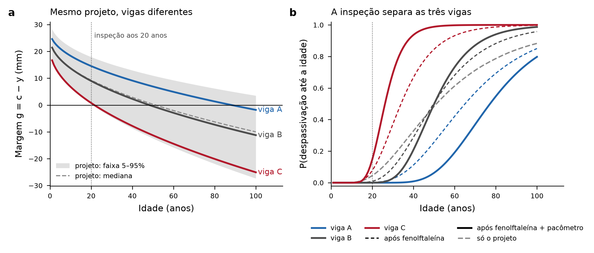
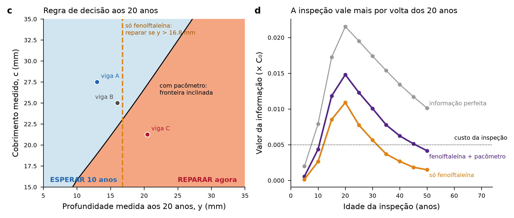

# Exemplo de referência: valor da informação de uma inspeção em viga carbonatada

*Rascunho da seção de exemplo de referência do paper final, escrito como no artigo e com notas explicativas ("Em palavras") que não entram no texto submetido.*

## Resumo do exemplo

Uma viga de concreto armado com f_c = 25 MPa, UR = 55% e cobrimento nominal de 25 mm, construída em 1980 sob a trajetória SSP2-4.5, é analisada para responder a duas perguntas: com que idade vale fazer uma inspeção, e se vale medir só a profundidade carbonatada ou também o cobrimento. A inspeção vale mais aos 20 anos: 0,0109·C₀ só com fenolftaleína e 0,0148·C₀ com fenolftaleína e pacômetro, contra um custo de 0,005·C₀. Ela paga o próprio custo entre cerca de 15 e 45 anos quando o cobrimento também é medido, e entre 15 e 30 anos com a fenolftaleína sozinha. A atualização baseada em quantis, que é a operação que o emulador fará no paper, reproduz a referência por amostragem por importância com diferença de no máximo 0,0007·C₀ no valor da informação e 0,004 na probabilidade de despassivação.

## 1. Objetivo

O exemplo tem três funções. Ele mostra, num caso pequeno, o que significa o valor da informação de uma inspeção. Verifica a atualização por quantis contra uma referência independente antes de qualquer uso do emulador. E fornece os números de referência contra os quais o emulador PyGLAM será validado no paper.

> **Em palavras.** Antes de pôr o emulador no meio, resolvemos o problema "na força bruta", com Monte Carlo do modelo de Possan, e conferimos que o atalho que o emulador vai usar dá a mesma resposta.

## 2. Descrição do problema

### 2.1 Elemento, modelo e estado-limite

A profundidade carbonatada segue o modelo de Possan (CP II F, ambiente externo protegido da chuva, sem adição pozolânica), com a concentração de CO₂ do ano-calendário pela trajetória SSP2-4.5 e máximo acumulado no tempo, como no manuscrito. A margem é

$$g(t) = c - y(t),$$

e a despassivação ocorre quando $g \le 0$. O horizonte é de 100 anos, em passos anuais.

### 2.2 Variáveis de projeto e latentes

As variáveis de projeto são $\mathbf{x} = \{f_c = 25\ \text{MPa},\ UR = 0{,}55,\ c_{nom} = 25\ \text{mm}\}$. Sobre elas atuam as latentes do manuscrito, $f_c^* = f_c\,\omega_{fc}$, $UR^* = UR\,\omega_{UR}$ e $c = c_{nom}\,\omega_c$. $\omega_{fc}$ e $\omega_c$ são lognormais de média 1 e CoV 0,15; $\omega_{UR}$ é normal (1; 0,15) truncada em $0 < \omega_{UR} < 1/UR$. A amostra a priori tem 200.000 realizações.

> **Em palavras.** O projeto diz 25 MPa e 25 mm. A obra entregou outra coisa em cada viga, e não sabemos o quê. As latentes representam essa diferença entre o projetado e o executado.

### 2.3 Modelo de inspeção

A inspeção pode medir a profundidade carbonatada por fenolftaleína, $y_{obs} = y(t_m) + \varepsilon_y$ com $\varepsilon_y \sim N(0;\ 2{,}5\ \text{mm})$, e o cobrimento por pacômetro, $c_{obs} = c + \varepsilon_c$ com $\varepsilon_c \sim N(0;\ 1{,}5\ \text{mm})$. O custo de uma inspeção é $\lambda_{insp} = 0{,}005\,C_0$.

### 2.4 Decisão e custos

Na idade da inspeção $t_m$ há duas ações. **R** é reparar agora. **E** é esperar 10 anos e reparar então. Nas duas a viga termina reparada; a decisão é sobre o momento. Os custos são adimensionais (múltiplos do custo de construção $C_0$), descontados à taxa real $r = 0{,}04$ até $t_m$:

$$C_R = \begin{cases}\lambda_{prev}, & g(t_m) > 0\\ \lambda_{corr}, & g(t_m) \le 0\end{cases}
\qquad
C_E = d^{10}\,C_R(t_m+10) + \lambda_{dep}\sum_{k=0}^{9} d^{k}\,\mathbb{1}[g(t_m+k)\le 0],$$

com $d = 1/(1+r)$, $\lambda_{prev} = 0{,}08$, $\lambda_{corr} = 0{,}32$ e $\lambda_{dep}$ o custo por ano em que a armadura fica despassivada. Esse último termo representa, de forma resumida, a fase de propagação: fissuração, desplacamento e o reparo maior que vem depois.

**Uma regra física para escolher $\lambda_{dep}$.** Uma viga já despassivada nunca deveria ficar esperando. Para isso, esperar tem de custar mais que reparar quando $g(t_m) \le 0$:

$$\lambda_{dep}\sum_{k=0}^{9} d^{k} + d^{10}\lambda_{corr} > \lambda_{corr}
\;\;\Longleftrightarrow\;\;
\lambda_{dep} > \lambda_{corr}\,\frac{1-d^{10}}{\sum_{k=0}^{9} d^{k}} = 0{,}0123\,C_0/\text{ano}.$$

Adota-se $\lambda_{dep} = 0{,}02$. O limite cresce com o custo corretivo: 0,0062 para $\lambda_{corr}/\lambda_{prev} = 2$, 0,0123 para 4 e 0,0246 para 8.

> **Em palavras.** Sem o termo de risco, o desconto financeiro sempre manda adiar, inclusive quando a armadura já está corroendo. Essa conta dá o menor custo anual de risco que impede essa decisão absurda. No esboço anterior, com 0,01, o modelo ainda mandava esperar com a viga despassivada.

## 3. Método

### 3.1 Atualização por quantis

A atualização se apoia numa propriedade verificada neste caso: as trajetórias de profundidade são comonotônicas no tempo. O coeficiente de Spearman entre $y(t_1)$ e $y(t_2)$ é maior que 0,99999 para os pares (10, 50), (20, 50), (20, 100) e (30, 60) anos. Para a margem $g$ ele cai para 0,92–0,99, porque o cobrimento é independente da profundidade. Então cada viga tem um quantil $u \in (0,1)$ que se mantém ao longo da vida, e a profundidade em qualquer idade é $y(t) = Q_t(u)$, em que $Q_t$ é a função quantil da profundidade na idade $t$. O cobrimento entra separado, $c \sim$ lognormal.

Dadas as leituras, a distribuição a posteriori é

$$p(u \mid y_{obs}) \propto \phi\!\left(\frac{y_{obs} - Q_{t_m}(u)}{\sigma_y}\right),
\qquad
p(c \mid c_{obs}) \propto p(c)\,\phi\!\left(\frac{c_{obs} - c}{\sigma_c}\right),$$

e a probabilidade de despassivação a posteriori em qualquer idade é

$$P[g(t) \le 0 \mid y_{obs}, c_{obs}] = \iint \mathbb{1}[c - Q_t(u) \le 0]\; p(u \mid y_{obs})\, p(c \mid c_{obs})\, du\, dc.$$

Usam-se 2000 pontos em $u$ e 400 em $c$. No paper, $Q_t(u)$ vem do emulador GLD-PCE-NN; aqui vem dos quantis empíricos da amostra a priori.

> **Em palavras.** Como as vigas não "trocam de lugar" na fila da carbonatação, basta uma leitura de fenolftaleína para saber em que posição da fila a viga está, e a partir daí sabemos sua profundidade em qualquer idade futura. O pacômetro diz, à parte, quanto concreto protege a barra.

### 3.2 Valor da informação

Sem inspeção escolhe-se a ação de menor custo esperado a priori, $a_0 = \arg\min_a E[C_a]$. Com inspeção escolhe-se, para cada leitura, a ação de menor custo esperado a posteriori, $a^*(z) = \arg\min_a E[C_a \mid z]$. O valor da informação é

$$VoI = E[C_{a_0}] - E_z\big[\,C_{a^*(z)}\,\big],$$

estimado por pré-posterior com 20.000 vigas "verdadeiras" sorteadas da priori, cada uma com leituras ruidosas simuladas. Calculam-se três versões: só profundidade ($z = y_{obs}$), profundidade e cobrimento ($z = \{y_{obs}, c_{obs}\}$) e informação perfeita (estado verdadeiro conhecido), que é o teto.

> **Em palavras.** Imaginamos 20.000 vigas reais, inspecionamos cada uma no computador, decidimos com base na leitura e comparamos o custo com o de decidir sem olhar. A diferença média é quanto a inspeção vale. Se for maior que o custo de inspecionar, vale a pena.

### 3.3 Verificação

A atualização por quantis é verificada contra amostragem por importância diretamente nas latentes ($\omega_{fc}, \omega_{UR}, \omega_c$), sem nenhuma hipótese de comonotonicidade, usando 100.000 amostras a priori e 10.000 vigas verdadeiras com duas sementes.

## 4. Resultados

### 4.1 Três vigas do mesmo projeto

A Figura 1a mostra três vigas com o mesmo projeto e latentes diferentes: A ($\omega_{fc} = 1{,}15$, $\omega_c = 1{,}10$), B (nominal) e C ($\omega_{fc} = \omega_c = 0{,}85$). Só com o projeto, o tempo até a despassivação tem P₅ = 21 anos e mediana de 52 anos, e P(despassivação até 50 anos) = 0,48 para qualquer viga.

| Viga | f_c real | c real | y aos 20 anos | g aos 20 anos | Despassiva aos |
|---|---|---|---|---|---|
| A | 28,8 MPa | 27,5 mm | 13,0 mm | 14,5 mm | 89 anos |
| B | 25,0 MPa | 25,0 mm | 16,0 mm | 9,0 mm | 49 anos |
| C | 21,2 MPa | 21,2 mm | 20,5 mm | 0,8 mm | 22 anos |

A Figura 1b mostra o que uma inspeção aos 20 anos faz com essa probabilidade. P(despassivação até 50 anos) passa de 0,48 para 0,26 (A), 0,50 (B) e 0,85 (C) só com a fenolftaleína, e para 0,06, 0,50 e 0,99 com o pacômetro também.

*Figura 1. (a) Margem g(t) de três vigas com o mesmo projeto e latentes diferentes, sobre a faixa 5–95% e a mediana a priori (200.000 realizações). (b) Probabilidade de despassivação até cada idade, a priori (cinza tracejado) e após inspeção aos 20 anos, só com fenolftaleína (tracejado) e com fenolftaleína e pacômetro (contínuo).*

> **Em palavras.** Para quem só tem o projeto, as três vigas são iguais. Depois da inspeção, a viga A tem folga de décadas e a viga C está no limite. A viga B continua parecida com a média, porque ela é a média.

### 4.2 Regra de decisão aos 20 anos

Sem inspeção, a decisão ótima aos 20 anos é reparar todas as vigas, porque esperar 10 anos expõe muitas delas à despassivação (P_f vai de 0,045 aos 20 anos para 0,168 aos 30). Com a fenolftaleína, a regra vira um limiar: **reparar se a profundidade medida passar de 16,8 mm**. Com o pacômetro, o limiar depende do cobrimento medido, e a fronteira fica inclinada (Figura 2c): uma viga com cobrimento maior tolera uma profundidade maior antes de exigir reparo. As decisões para as três vigas são esperar (A), esperar (B) e reparar (C), tanto com a fenolftaleína sozinha quanto com o pacômetro.

> **Em palavras.** O ganho da inspeção vem de dois lados. Para A e B, ela permite adiar um reparo que, sem informação, seria feito por precaução. Adiar 10 anos um reparo de 0,08·C₀ economiza cerca de 0,026·C₀ em valor presente. Para C, ela confirma que o reparo é urgente.

*Figura 2. (c) Ação ótima aos 20 anos em função das leituras de profundidade e cobrimento (fronteira contínua) e limiar quando só a profundidade é medida (tracejado laranja, 16,8 mm); os pontos são as leituras das vigas A, B e C. (d) Valor da informação pela idade da inspeção para só fenolftaleína, fenolftaleína e pacômetro, e informação perfeita; a linha pontilhada é o custo de uma inspeção (0,005·C₀). Pré-posterior com 20.000 vigas.*

### 4.3 Quando inspecionar

| Idade (anos) | Ação sem inspeção | P_f a priori | VoI só fenolftaleína | VoI fenolftaleína + pacômetro | VoI perfeita |
|---|---|---|---|---|---|
| 5 | esperar | 0,000 | 0,0001 | 0,0006 | 0,0020 |
| 10 | esperar | 0,002 | 0,0026 | 0,0044 | 0,0079 |
| 15 | esperar | 0,013 | 0,0085 | 0,0118 | 0,0172 |
| 20 | reparar | 0,045 | 0,0109 | 0,0148 | 0,0215 |
| 25 | reparar | 0,098 | 0,0078 | 0,0123 | 0,0195 |
| 30 | reparar | 0,168 | 0,0056 | 0,0101 | 0,0174 |
| 35 | reparar | 0,247 | 0,0037 | 0,0078 | 0,0154 |
| 40 | reparar | 0,329 | 0,0027 | 0,0062 | 0,0134 |
| 45 | reparar | 0,409 | 0,0018 | 0,0051 | 0,0117 |
| 50 | reparar | 0,483 | 0,0015 | 0,0042 | 0,0101 |

O valor da informação tem máximo aos 20 anos, exatamente onde a decisão a priori muda de "esperar" para "reparar". Com fenolftaleína e pacômetro a inspeção paga o próprio custo de cerca de 15 a 45 anos; com a fenolftaleína sozinha, de 15 a 30 anos. A combinação vale mais que a fenolftaleína em todas as idades.

> **Em palavras.** Cedo demais, todas as vigas ainda estão longe da armadura e a resposta seria "esperar" de qualquer jeito: medir não muda nada. Tarde demais, boa parte já despassivou e a resposta seria "reparar" de qualquer jeito. A inspeção vale mais quando a dúvida é maior, perto do momento em que a decisão sem informação está prestes a virar.

### 4.4 Verificação e convergência

| Idade | VoI só fenolftaleína: quantis | Referência (importância, 10.000 vigas) | VoI fenolftaleína + pacômetro: quantis | Referência |
|---|---|---|---|---|
| 20 | 0,0109 | 0,0102 | 0,0148 | 0,0148 |
| 30 | 0,0056 | 0,0050 | 0,0101 | 0,0097 |

A maior diferença é de 0,0007·C₀. Nas curvas a posteriori das três vigas, a diferença máxima entre os dois métodos é de 0,004 na probabilidade de despassivação. Com 20.000 vigas no pré-posterior, três sementes dão VoI entre 0,0108 e 0,0110 (fenolftaleína) e entre 0,0148 e 0,0153 (com pacômetro) aos 20 anos. Com 1.000 vigas, a faixa é 0,0102–0,0118, o que mostra que estimativas com poucas vigas têm ruído da ordem de 0,001·C₀.

### 4.5 Sensibilidade

Foram variados $\lambda_{corr}/\lambda_{prev} \in \{2, 4, 8\}$, $\lambda_{dep} \in \{0{,}0123;\ 0{,}02;\ 0{,}04\}$ e $\sigma_y \in \{1{,}5;\ 2{,}5;\ 4{,}0\}$ mm, com 5.000 vigas por ponto. Das 27 combinações, 6 violam a regra física da Seção 2.4 (razão 8 com $\lambda_{dep}$ de 0,0123 ou 0,02, abaixo do limite de 0,0246) e foram descartadas. As três com $\lambda_{dep} = 0{,}0123$, a mais distante do limite, produzem o resultado espúrio de idade ótima aos 45 anos; as três com $\lambda_{dep} = 0{,}02$ dão 15 anos, mas também são descartadas porque o modelo de decisão ainda permite que uma viga despassivada espere. Nas 21 combinações consistentes:

1. A idade ótima da inspeção fica entre 15 e 30 anos.
2. Medir também o cobrimento vale mais que medir só a profundidade em todas as combinações.
3. Uma fenolftaleína mais precisa aumenta o valor: o VoI máximo com pacômetro vale, em média, 0,0173, 0,0156 e 0,0132·C₀ para σ_y = 1,5, 2,5 e 4,0 mm.

| λ_corr/λ_prev | λ_dep | Idade ótima | VoI máx. (fenolftaleína + pacômetro) | VoI máx. (só fenolftaleína) | Janela que paga a inspeção |
|---|---|---|---|---|---|
| 2 | 0,0123 | 30 | 0,0121 | 0,0087 | 20–50 |
| 2 | 0,02 | 25 | 0,0138 | 0,0100 | 15–45 |
| 2 | 0,04 | 20 | 0,0164 | 0,0116 | 15–40 |
| 4 | 0,0123 | 20 | 0,0164 | 0,0121 | 15–45 |
| 4 | 0,02 | 20 | 0,0149 | 0,0103 | 15–40 |
| 4 | 0,04 | 15 | 0,0186 | 0,0141 | 10–40 |
| 8 | 0,04 | 15 | 0,0170 | 0,0118 | 10–35 |

*σ_y = 2,5 mm. A janela é calculada com 5.000 vigas; no caso-base, com 20.000 vigas, ela vai até 45 anos porque o VoI aos 45 anos (0,0051) fica praticamente no custo da inspeção.*

## 5. O exemplo faz sentido?

Cinco comportamentos esperados de engenharia foram conferidos:

1. **Sem utilidade cedo e tarde.** O valor é quase zero aos 5 anos e cai depois dos 20, como esperado de uma decisão que só é incerta numa janela.
2. **Mais informação vale mais.** Informação perfeita > fenolftaleína + pacômetro > só fenolftaleína, em todas as idades e combinações.
3. **Medida melhor vale mais.** Reduzir σ_y aumenta o valor.
4. **Regra de decisão coerente.** Limiar em profundidade de 16,8 mm, e fronteira que tolera mais profundidade quando o cobrimento é maior.
5. **Viga despassivada não espera.** Garantido pela escolha de λ_dep acima do limite físico; sem isso o modelo dá respostas absurdas, e a sensibilidade mostrou exatamente esse efeito nas combinações descartadas.

## 6. Limitações

A decisão é de um único passo (reparar agora ou em 10 anos) e não considera o que acontece depois do reparo; no paper ela é substituída pela política ao longo da vida com reparo "Solução 1". O custo de risco λ_dep é uma representação resumida da propagação e precisa de calibração. O modelo de Possan não tem validação independente em revista JCR e quase não responde ao CO₂ atmosférico, o que torna o cenário SSP pouco relevante neste exemplo. Os erros de medida são gaussianos e não enviesados, e não há correlação espacial ao longo da viga.

## 7. Como o exemplo entra no paper

No paper, a função quantil $Q_t(u)$ vem do emulador PyGLAM retreinado para a profundidade, e não dos quantis empíricos. Este exemplo é então repetido com o emulador, e a Seção 4.4 vira a validação pela decisão: o emulador tem de reproduzir os VoI da tabela da Seção 4.3 e a regra de decisão da Figura 2c. Depois disso, o mesmo cálculo é feito para todo o espaço de projeto (mapas de idade ótima e de valor por f_c, UR e c_nom), o que só é viável com o emulador.

## Arquivos do exemplo

- Script reprodutível: [bench_voi.py](bench_voi.py)
- Tabelas: [bench_vigas.csv](bench_vigas.csv), [bench_voi_idade.csv](bench_voi_idade.csv), [bench_verificacao_IS10k.csv](bench_verificacao_IS10k.csv), [bench_convergencia.csv](bench_convergencia.csv), [bench_sensibilidade.csv](bench_sensibilidade.csv)
- Resumo numérico: [bench_resumo.json](bench_resumo.json)
