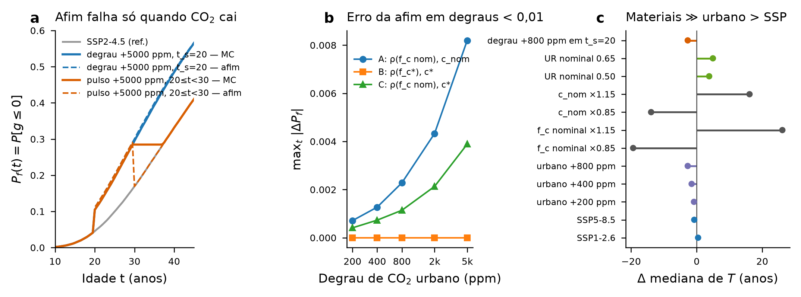
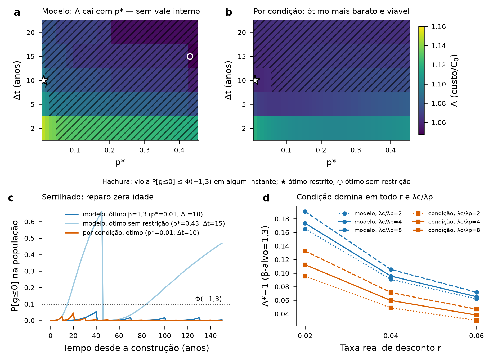
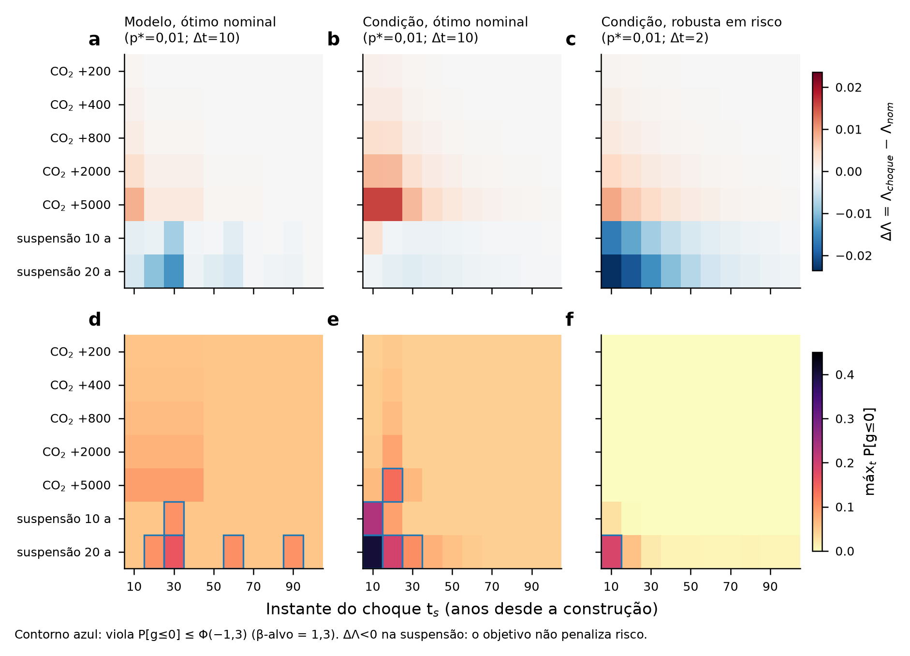
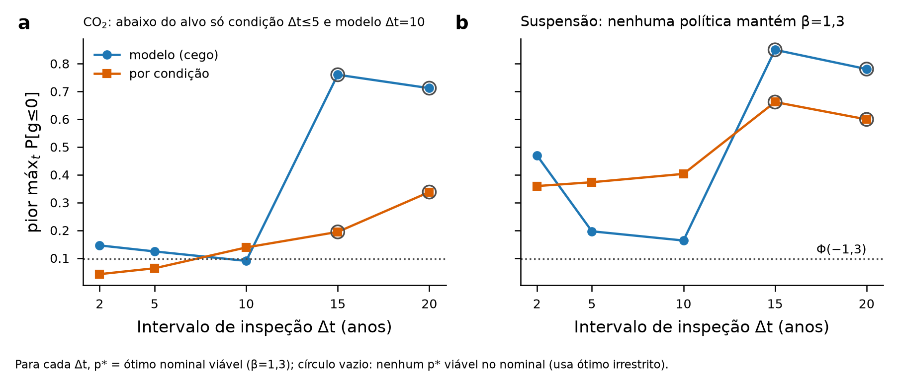
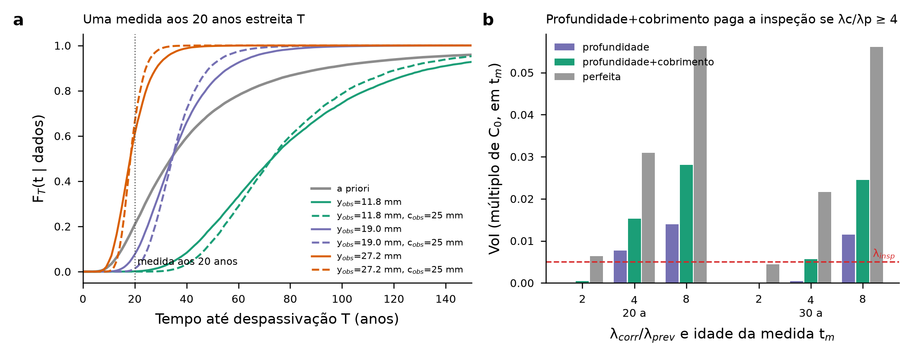

# Exemplos numéricos — métodos, hipóteses e resultados (protótipos para perguntas de pesquisa)

Todos os resultados vêm de **Monte Carlo direto do modelo de Possan et al. (2016) em forma fechada** (CP II F, exposição externa protegida PEA, k_c=21,68; k_fc=1,50; k_CO2=18,00; k_UR=1100; k_ce=1,00; ad=0), não do emulador PyGLAM. Código: [e_common.py](e_common.py) (modelo, latentes, CO₂) e [e_sim.py](e_sim.py) (simulador de manutenção).

## 0. Hipóteses comuns

- Profundidade: $y(t)=k_c(20/f_c^*)^{k_{fc}}\sqrt{t/20}\exp[k_{CO_2}\sqrt{CO_2(a_0+t)}/(60+f_c^*) - k_{UR}(UR^*-0{,}58)^2/(100+f_c^*)]\,k_{ce}$, com $CO_2[\%]=\text{ppm}/10^4$ por ano-calendário e máximo acumulado (cummax) no tempo; $g(t)=c-y(t)$.
- Latentes: $f_c^*=f_c\omega_{fc}$, $c=c_{nom}\omega_c$ lognormais (média 1, CoV 0,15); $UR^*=UR\,\omega_{UR}$, $\omega_{UR}\sim N(1;0{,}15)$ truncada em $(0,1/UR)$. Independentes.
- **Sanidade (caso-base do manuscrito**: f_c=25 MPa, UR=55%, c_nom=25 mm, construção 1980, SSP2-4.5, 10⁵ amostras, passo anual): P[T≤100]=0,8850; mediana de T (todas as amostras)=51,08 anos; mediana condicional aos que cruzam=47,18 anos. O manuscrito reporta 84,86% e 48,18 anos — diferença de ≈3,6 p.p. em P e ≈1 ano na mediana condicional. A malha temporal (0,25/1/10 anos) não altera o resultado (P=0,8850 nos três casos); a diferença provavelmente vem de o manuscrito reportar valores do emulador ou de outra semente/definição de mediana — **não foi reconciliada**.
- **Horizonte além de 2100 (E2–E4)**: construção em 2000, T_SL=150 anos (até 2150), **CO₂ mantido constante no valor de 2100 (602,8 ppm, SSP2-4.5)**. Sensibilidade: extrapolação linear da tendência 2090–2100, construção em 1950 (série completa) e T_SL=100 (seção 2.5).

## 1. E1 — Invariância afim de CO₂

**Equação testada.** Se $\rho(t)=\exp\{k_{CO_2}[\sqrt{CO_2^{cen}(t)}-\sqrt{CO_2^{ref}(t)}]/(60+f_c)\}$, então $g_{cen}=c(1-\rho)+\rho\,g_{ref}$. Três aproximações, comparadas ao MC “verdadeiro” (mesmas 10⁵ amostras, referência SSP2-4.5, caso-base 1980–2080, passo 0,5 ano):
- **A** (a que o emulador usaria): ρ com f_c nominal e deslocamento com c_nom, aplicada à distribuição de g_ref (mapa de quantis);
- **B**: ρ com f_c* e c* por realização (isola o efeito do cummax);
- **C**: ρ com f_c nominal e c* por realização (isola o efeito de f_c latente).

**Resultados** ([E1_invariancia_afim_erros.csv](E1_invariancia_afim_erros.csv), [E1_curvas_Pf.csv](E1_curvas_Pf.csv)):
- SSP1-2.6 e SSP5-8.5 vs SSP2-4.5 (aprox. A, g_lim=0): max_t|ΔP_f| = 0.0003 e 0.0003; ρ_max(SSP5)=1.0111.
- Degraus urbanos em t_s=20 (aprox. A): +200 ppm → 0.0007; +800 → 0.0023; +5000 (estresse) → 0.0082 (ρ_max=1.121). Erro em quantis de g aos 50 anos para +5000: q05 -0.033 mm, q95 +0.373 mm; KS(g, t=50)=0.0074. Quantis 5/50% de T idênticos à resolução de 0,5 ano em todos os degraus (T95 > horizonte).
- A aproximação **B tem erro nulo** (≤1e-4) em todos os degraus e cenários SSP: com CO₂ crescente, o cummax não atua, e a afim é **exata por realização**. O erro de A vem de usar f_c e c nominais; C mostra que cerca de metade vem de c_nom e metade de f_c nominal.
- **Onde a afim falha: CO₂ decrescente.** Pulso de +800 ppm entre 20 e 30 anos: max|ΔP_f| = 0.0222; pulso +5000: 0.1156, igual em A, B e C. O cummax mantém a profundidade num patamar que a transformação afim não representa (Fig. a).
- **Modelo sem memória.** Com a forma fechada, um degrau em t_s=0, 20 ou 40 anos produz **a mesma distribuição de g para t≥t_s** (ver as colunas dq de E1). Um choque de CO₂ eleva a profundidade de imediato, como se sempre tivesse existido. Numa formulação incremental (y² acumulado com a taxa instantânea de Possan), o choque +800 ppm em t_s=20 desloca a mediana de T em -1.38 anos (construção 2020), contra -2.73 na forma fechada; para +5000: -5.72 vs -9.75. Na formulação incremental a afim continua exata por realização, mas ρ passa a depender do histórico de CO₂.
- **Magnitudes** ([E1_magnitude_efeitos_T50.csv](E1_magnitude_efeitos_T50.csv), deslocamento da mediana de T, g_lim=0, construção 2020, horizonte 80 anos): SSP5-8.5 -0.74; SSP1-2.6 +0.43; microclima urbano +200/+400/+800 ppm: -0.82/-1.53/-2.73; f_c nominal ×0,85/×1,15: -19.4/+26.1; c_nom ×0,85/×1,15: -13.9/+16.1 anos. Dispersão latente (SSP2-4.5, 1980): T05=20.6 e T50=51.1 anos. Na construção de 1980 (até 2080), o efeito SSP é ≤0,04 ano, porque a travessia mediana ocorre por volta de 2030, quando os cenários ainda não divergiram.

**O que E1 sugere.** (i) A invariância afim, com ρ em f_c nominal, é numericamente quase exata para CO₂ monotônico (|ΔP_f|<0,01 até +5000 ppm). Isso permite transferir cenários sem retreinar, mas a contribuição é pequena, porque o próprio efeito do CO₂ no modelo de Possan é fraco (ρ≤1,03 para +800 ppm). (ii) A pergunta mais forte está no **efeito memória/cummax**: a forma fechada responde de imediato e sem histórico a variações de CO₂, e superestima o impacto de choques em cerca de 2× em relação a uma formulação incremental. (iii) Para esta peça, a hierarquia de incertezas é materiais/execução (~15–26 anos) ≫ UR (~4–5 anos) > microclima urbano (~1–3 anos) > cenário SSP (<1 ano).

## 2. E2 — Superfície de custo Λ(p*,Δt) com reparo “Solução 1”

**Caso** (documento de discussão): f_ck,0=20; f_ck,arg=30 (com nova latente lognormal CoV 0,15 a cada reparo); UR=0,70; c_nom=25 mm; T_SL=150; r=0,04; λ_insp=0,005; λ_prev=0,08; λ_corr=0,32; ε=0 (base). O reparo zera a idade, mantém c (a mesma latente ω_c do elemento) e UR*, e o CO₂ segue o ano-calendário.

**Função objetivo implementada**: $\Lambda=1+\sum_t (1+r)^{-t}[\lambda_{insp}n_{insp}(t)+\lambda_{prev}n_{prev}(t)+\lambda_{corr}n_{corr}(t)]$, com $n$ = fração da população inspecionada, reparada preventivamente (g>0) ou corretivamente (g≤0) no ano t. Na variante “modelo”, isso equivale exatamente a $\delta_j[\lambda_{corr}\pi_j+\lambda_{prev}(1-\pi_j)]$ do documento (com ε=0).
- **Variante “modelo” (formulação do documento)**: π_j=P[g≤ε] vem de tabelas populacionais (4×10⁴ amostras) no estado (material, ano do último reparo, idade). O reparo vale para toda a população se π_j>p*, e o **cronograma é determinístico**: a inspeção não observa nada.
- **Variante “por condição”**: 2×10⁴ realizações. Cada uma é inspecionada a cada Δt; mede-se y com σ_y=2,5 mm e o cobrimento por pacômetro (σ_c=1,5 mm, erro fixo por elemento). Repara-se se P[g≤ε | medida]>p*, isto é, se g_med < ε − σ_g Φ⁻¹(p*), com σ_g=2,92 mm. O custo é corretivo se o g verdadeiro for ≤0.
- Restrição: P[g≤0](t) ≤ Φ(−β_alvo) **em todo ano** (a versão “só nos instantes de inspeção” deu os mesmos ótimos).

**Resultados** ([E2_superficie_Lambda.csv](E2_superficie_Lambda.csv), [E2_trajetorias_Pf.csv](E2_trajetorias_Pf.csv)):
- **Ciclos de reparo**: na variante modelo com β=1,3, ótimo p*=0.01, Δt=10, reparos aos 10, 40, 70, 100 e 130 anos (5 dentes, ≥2 ✓). Na variante por condição (ótimo p*=0.01, Δt=10), são 2.94 reparos em média por elemento (q05–q95: 1–6).
- **Sem restrição, Λ da variante modelo é monotonicamente decrescente em p* — não há vale interior.** O ótimo econômico puro é p*=0.43, Δt=15, Λ=1.0476, com max P_f=0.662 (β implícito ≈ −0,42). Como a função objetivo não penaliza o tempo em estado despassivado, o desconto favorece adiar. Um dos dois reparos desse ótimo ocorre em t=150, artefato de fim de horizonte da fórmula J=⌊T_SL/Δt⌋.
- Com β_alvo=1,3: modelo Λ*=1.0956 (custo de durabilidade 0.0956·C₀) contra condição Λ*=1.0597 (0.0597·C₀, max P_f=0.045). **A política por condição reduz o custo de durabilidade em 38%** e satisfaz a restrição sem que ela seja ativa. Na variante modelo, a restrição é ativa e define o ótimo.
- O ótimo por condição fica na borda inferior da grade (p*=0,01), e o ótimo restrito do modelo também. Grade fixada pela tarefa: p*∈[0,01;0,45] com passo 0,01 × Δt∈{2,5,10,15,20}.
- **Sensibilidade** ([E2_sensibilidade_r_razao_beta.csv](E2_sensibilidade_r_razao_beta.csv)): para β=1,3, a variante por condição é mais barata nas 9 combinações r∈{0,02;0,04;0,06} × λ_corr/λ_prev∈{2,4,8}. O ótimo restrito do modelo é sempre (0,01;10). Na variante por condição, o ótimo migra para Δt=5 com razão 8 e para p*=0,05 com razão 2. Com razão 2 e r≥0,04, o ótimo por condição irrestrito degenera para (0,45;20), com max P_f=0,37.
- **Hipóteses de CO₂/horizonte e ε** ([E2_sensibilidade_CO2_horizonte_eps.csv](E2_sensibilidade_CO2_horizonte_eps.csv)): CO₂ constante ou linear após 2100 → Λ idêntico a 4 casas (o desconto a 4% e a baixa sensibilidade ao CO₂ anulam a diferença). Com construção em 1950, Λ*_cond=1,0591 e Λ*_mod=1,0954; com T_SL=100, 1,0590 e 1,0949. A política ótima não muda. Com ε=5 ou 10 mm, o Λ* restrito do modelo não muda (1,0956) e o p* ótimo absorve a margem: ε e p* são redundantes, como antecipava o documento.

**O que E2 sugere.** A formulação Λ do documento é um cronograma de substituição periódica disfarçado de política por inspeção: π vem do modelo, e o ótimo é determinado pela restrição de β, não por um vale econômico. A pergunta mais publicável é **quanto vale observar** (variante por condição, −38% no custo de durabilidade) e como formular um objetivo com custo de risco/propagação, para que o ótimo econômico não seja “deixar despassivar”.

## 3. E3 — Robustez a choques (CO₂ urbano e suspensão de inspeções)

Cenários: degrau de CO₂ +200/+400/+800 ppm e, por estresse, +2000/+5000 ppm, a partir de t_s∈{10,…,100}; suspensão de inspeções por N∈{10,20} anos a partir de t_s. São 70 cenários × 450 políticas, com 2×10⁴ realizações cada. A variante modelo é **cega** ao choque de CO₂ (π vem do modelo nominal). Na suspensão, as duas variantes pulam as inspeções. Política robusta: escolhida entre as viáveis no nominal (β=1,3) por minimax-regret, melhor custo no pior caso e menor max P_f no pior caso ([E3_politicas_robustas.csv](E3_politicas_robustas.csv), [E3_choques_todas_politicas.csv](E3_choques_todas_politicas.csv)).

- **ΔΛ é pequeno e enganoso.** Para choques de CO₂, ΔΛ ≤ 0,019·C₀ mesmo a +5000 ppm. Na suspensão, **ΔΛ<0** (até −0,014 no modelo e −0,024 na robusta Δt=2): pular inspeções economiza, porque o objetivo não cobra o risco. Por isso, a métrica de robustez relevante é o risco (max P_f e anos acima do alvo), não ΔΛ.
- **Minimax-regret ≈ ótimo nominal** (modelo: (0,02;5); condição: (0,02;10)) e **melhor-no-pior-caso = ótimo nominal** (0,01;10) nas duas variantes, ou seja, não há trade-off de custo. Há trade-off de risco: o menor max P_f no pior caso exige Δt=2 (modelo: Λ_nom=1,1491 e max P_f no pior caso 0,116; condição: 1,1189 e 0,186). **Nenhuma política da grade mantém β=1,3 em todos os cenários de suspensão.**
- **Hipótese “inspeção frequente compra informação”** ([E3_hipotese_informacao.csv](E3_hipotese_informacao.csv)): para choques de CO₂, a variante por condição com Δt=2 (p*=0,24) e Δt=5 (p*=0,08) mantém o pior max P_f em 0,042 e 0,064, abaixo de Φ(−1,3)=0,097. A variante modelo cega, nos mesmos Δt, chega a 0,146 e 0,124 (8 e 4 anos acima do alvo). **Confirmada para choques ambientais**, desde que a inspeção observe. Com Δt=10, a vantagem se inverte (condição 0,138, acima do alvo, vs modelo 0,090, abaixo do alvo), porque a condição opera mais perto do limiar.
- **Suspensão de 20 anos penaliza mais a política por condição** (pior max P_f 0,40 com Δt=10, contra 0,16 no modelo): a política “just-in-time” por elemento tem menos folga do que a substituição periódica. É um trade-off eficiência × resiliência.

**O que E3 sugere.** “Resiliência de políticas de manutenção a choques exógenos” é viável como pergunta, mas exige (i) um objetivo com penalidade de risco/indisponibilidade, sem a qual a suspensão parece vantajosa, e (ii) políticas que observam o estado. O resultado “eficiência por condição × folga da substituição periódica sob perda de informação” é um achado de tipo RESS.

## 4. E4 — Valor da informação de uma medida de carbonatação

**Método**: o mesmo caso de E2. Prior de 5×10⁴ amostras das latentes (ω_fc, ω_UR, ω_c). Medida de y aos t_m=20 ou 30 anos com σ_y=2,5 mm e, opcionalmente, de c por pacômetro com σ_c=1,5 mm. Posterior por amostragem por importância (pesos gaussianos na verossimilhança; ESS ≥ 3,3×10³ nos exemplos). Decisão em t_m: **A = reparar agora** (custo λ_prev, ou λ_corr se g(t_m)≤0, + K) ou **B = esperar 10 anos e reparar** (o mesmo custo avaliado em t_m+10, descontado a r=0,04). K = valor presente das renovações futuras da argamassa (λ_prev/((1+r)^112−1)=0,001, com 112 anos de mediana de T da argamassa). Pré-posterior com 4000 elementos “verdadeiros” independentes. VoI = E[custo | decisão a priori] − E[custo | decisão com dados], em múltiplos de C₀ **no instante t_m** ([E4_valor_informacao.csv](E4_valor_informacao.csv)).

- A priori: P_f(20)=0,208, P_f(30)=0,426, P_f(40)=0,593.
- t_m=20, razão 4: VoI(profundidade)=0.0077; VoI(profundidade+cobrimento)=0.0152; EVPI=0.0309. VoI líquido de λ_insp: 0.0027 e 0.0102.
- Razão 2: VoI(profundidade)=0 em t_m=20 e 30 (a decisão a priori “esperar” não muda). Razão 8, t_m=20: 0.0139 / 0.0280 / EVPI 0.0563.
- t_m=30, razão 4: só a medida combinada paga a inspeção (0.0057 > 0,005). A profundidade sozinha vale 0.0004.
- **O pacômetro dobra o VoI** (razão 4, t_m=20: 2.0×), porque c tem CoV igual ao de f_c e entra diretamente em g.
- Posteriores de exemplo ([E4_posteriores_exemplos.csv](E4_posteriores_exemplos.csv), [E4_cdf_posterior_T.csv](E4_cdf_posterior_T.csv)): a priori, T05/T50/T95 = 12,1/34,0/134 anos. Com y_obs aos 20 anos igual aos quantis a priori 10/50/90% (11,8/19,0/27,2 mm), a mediana posterior de T passa a 73,0/34,3/18,2 anos. Com c_obs=25 mm, o intervalo 5–95% para y_obs=19,0 encolhe de 18,5–65,4 para 22,9–54,5 anos. Decisão (razão 4): esperar / reparar agora / **esperar**. Esta última é perversa: se o elemento já está despassivado (P=0,61–0,98), o custo corretivo já está “garantido” e o desconto manda adiar. É o mesmo defeito do objetivo visto em E2 e E3.

**O que E4 sugere.** A pergunta de VoI/pré-posterior para inspeção de carbonatação (que medida, quando, com que precisão) é bem posta e barata com o simulador. O valor da medida depende fortemente de λ_corr/λ_prev e de medir também o cobrimento. O emulador GLD-PCE seria o meio de tornar o cálculo pré-posterior barato por projeto.

## 5. Síntese para a escolha da pergunta

1. A transferência afim de cenários de CO₂ é quase exata para CO₂ monotônico, mas o efeito do CO₂ em Possan é pequeno. Como contribuição isolada, é fraca; como lema metodológico dentro de outro paper, é útil, e a limitação de “memória”/cummax é uma ressalva necessária.
2. A formulação Λ com π vindo do modelo não tem vale econômico e não usa informação. Passar para política por condição com erro de medição e penalidade de risco transforma o problema num problema de decisão sequencial com informação, bem alinhado a RESS e Structural Safety.
3. Choques: a métrica deve ser de risco ou resiliência. Inspeção frequente compra informação contra choques ambientais, mas a política por condição é frágil à perda de informação (suspensão).
4. O VoI de uma medida de profundidade com pacômetro supera o custo de inspeção quando λ_corr/λ_prev ≥ 4, o que motiva planejar inspeções por VoI.

## 6. Simplificações e limitações

- MC direto da forma fechada, não o emulador. As tabelas populacionais usam 4×10⁴ amostras, os simuladores de política 2×10⁴ realizações (semente fixa, a mesma em todas as políticas, o que faz das comparações entre políticas amostras pareadas), E1 usa 10⁵ amostras e E4 usa 5×10⁴ (prior) × 4000 (verdades). Os valores de VoI ≲0,001 estão dentro do ruído de MC (provisórios).
- Malha anual em E2–E4 (cummax anual); inspeções em anos inteiros.
- O custo é corretivo quando o g verdadeiro ≤ 0, independentemente de ε; ε entra só no gatilho. Não há custo de propagação ou indisponibilidade (a fórmula do documento). Em E4, A e B incluem o valor de continuação K aproximado.
- Erro de medição gaussiano e não viesado; o cobrimento é medido uma vez por elemento (erro fixo). Não há correlação espacial.
- A latente de UR é truncada em (0,1/UR); os reparos sorteiam nova latente de f_c,arg e mantêm ω_c e ω_UR do elemento.
- Choques de CO₂ como degrau aditivo em ppm sobre o SSP2-4.5. Valores de +2000/+5000 ppm são de estresse (dentro da faixa de calibração de Possan, 0,1–1,2%, mas acima do microclima urbano típico).
