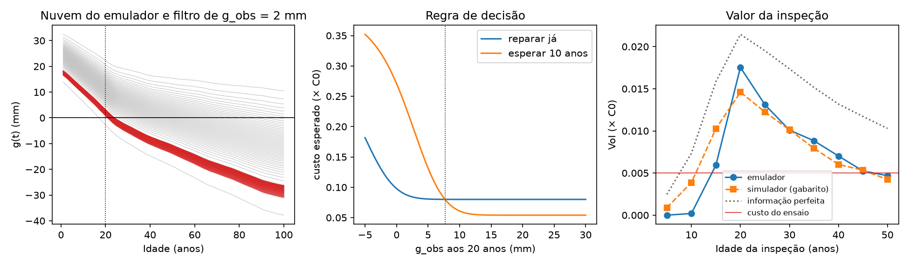

# Tutorial do benchmark — valor da inspeção com o emulador de g(t)

Este tutorial reproduz, passo a passo, o exemplo de referência do paper final usando o **seu emulador PyGLAM de g(t)** (as NNs de λ₁ e λ₂ já treinadas na pasta `durability/`). Cada passo diz o que fazer, qual trecho do script roda, que número deve sair e como interpretá-lo.

- Script: [tutorial_benchmark_g.py](tutorial_benchmark_g.py). A partir da raiz do repositório, rode `python paper_final/tutorial_benchmark_g.py` no `.venv` do projeto (a saída vai para `paper2_bench/`). Ele leva cerca de 20 s.
- Saída de referência: [tutorial_run_log.txt](saida_referencia/tutorial_run_log.txt). Se os seus números baterem com esse log, o ambiente está certo.
- O script roda de ponta a ponta. Os números deste tutorial saíram dessa execução.

---

## Passo 0 — Fixar o caso e as regras de custo

**O que é.** Escolhe-se uma viga de projeto e as regras do jogo econômico.

| Item | Valor | Comentário |
|---|---|---|
| Projeto x | f_c = 25 MPa, UR = 55 %, c_nom = 25 mm | Caso-base do Paper 1 (CP II F, PEA, 1980, SSP2-4.5) |
| Reparo preventivo λ_prev | 0,08·C₀ | Armadura ainda passivada |
| Reparo corretivo λ_corr | 0,32·C₀ | Armadura já despassivada |
| Risco λ_dep | 0,02·C₀ por ano despassivado | Ver a regra física abaixo |
| Inspeção λ_insp | 0,005·C₀ | Fenolftaleína + pacômetro |
| Desconto | 4 % a.a. → d¹⁰ = 0,6756; Σd^k (k = 0…9) = 8,435 | |
| Erros de medida | σ_y = 2,5 mm; σ_c = 1,5 mm → σ_g = √(2,5² + 1,5²) = 2,92 mm | **Hipóteses**; justificar no paper |

**Regra física do λ_dep.** Esperar 10 anos com a peça já despassivada tem de custar mais que reparar agora:

λ_dep > λ_corr(1 − d¹⁰)/Σd^k = 0,32 × 0,3244 / 8,435 = **0,0123**

Abaixo desse valor o modelo aconselharia deixar a armadura corroer, o que é absurdo. O script imprime esse limite (`ldep_min`).

**Saída esperada.** `sigma_g = 2.92 mm | d^10 = 0.6756 | soma d^k = 8.435 | lambda_dep mínimo = 0.0123`.

---

## Passo 1 — A nuvem do emulador

**O que é.** Para x fixo, a NN dá λ₁(t) e λ₂(t); λ₃ e λ₄ ficam fixos na média do dataset, como no Paper 1. Com a função quantil da GLD (`gld_quantile_at_u`), cada nível u ∈ (0,1) vira uma trajetória:

g_u(t) = Q_GLD(u; λ(t)), para t = 1…100 anos.

São 2000 níveis u, cada um com peso 1/2000. A matriz `QG[u, t]` **é a nuvem**: cada linha é uma viga possível, e mantém o mesmo u ao longo do tempo (o acoplamento quantílico do Paper 1).

**Saída esperada.** P[g ≤ 0] = 0,005 / 0,119 / 0,453 / 0,848 aos 20 / 30 / 50 / 100 anos. **O 0,848 é o 84,86 % do manuscrito.**

---

## Passo 2 — O gabarito: o simulador em trajetórias (achado importante)

**O que é.** Roda-se o mesmo Possan com as mesmas latentes (CoV 0,15, `ad = 0`) usando as funções do `functions.py`, mas guardando a trajetória inteira de cada viga. É Monte Carlo direto com 100 mil vigas. Serve de "verdade" para testar o emulador.

**Saída esperada** ([passo2_diagnostico_emulador.csv](saida_referencia/passo2_diagnostico_emulador.csv)):

| Idade | P_f simulador | P_f emulador | g 5 % sim | g 5 % emu |
|---|---|---|---|---|
| 10 | 0,002 | 0,000 | 6,4 | 11,9 |
| 20 | **0,045** | **0,005** | 0,3 | 3,8 |
| 25 | 0,099 | 0,050 | −2,2 | 0,0 |
| 30 | 0,169 | 0,118 | −4,5 | −2,4 |
| 50 | 0,486 | 0,452 | −12,4 | −9,8 |
| 100 | 0,882 | 0,848 | −27,3 | −25,2 |

**Interpretação.**
- A diferença entre os 88,5 % do MC e os 84,86 % do manuscrito está resolvida. **O simulador dá 88 %; os 84,86 % vêm do emulador.** Rodei `emulator_function_time_durability` no caso-base e ele dá 0,881 aos 100 anos, igual ao MC.
- O erro está na **cauda inferior** em idades baixas. Aos 20 anos o emulador vê 0,5 % de vigas despassivadas onde há 4,5 %.
- Causa provável: (i) λ₃ e λ₄ fixos em 0,198 e 0,130, quando o ajuste local da GLD no caso-base dá λ₃ ≈ 0,03–0,07; (ii) a NN aprendeu o tempo com só 5 nós (0, 25, 50, 75, 100 anos).
- Isso não invalida o paper. **É justamente o teste de "validação pela decisão" (Passo 6)**: o erro de probabilidade importa para a decisão?

---

## Passo 3 — Custo de cada trajetória para as duas ações

**O que é.** Aos t_m anos há duas ações, aplicadas a uma trajetória g(t):

- **R (reparar já):** λ_prev se g(t_m) > 0; senão λ_corr.
- **E (esperar 10 anos e reparar):** d¹⁰ × [λ_prev se g(t_m + 10) > 0; senão λ_corr] + λ_dep × Σ_{k=0}^{9} d^k · 1[g(t_m + k) ≤ 0].

A função `costs()` aplica isso a todas as linhas da nuvem de uma vez. Há só três tipos de viga, e o custo depende do tipo:

| Tipo | R | E | Melhor |
|---|---|---|---|
| 1 — passiva até t_m + 10 | 0,080 | 0,6756 × 0,08 = **0,054** | esperar |
| 2 — despassiva durante a espera (ex.: no ano 25) | 0,080 | 0,216 + 0,02 × 3,81 = **0,292** | reparar |
| 3 — já despassivada em t_m | 0,320 | 0,216 + 0,02 × 8,435 = **0,385** | reparar |

A conta do tipo 2 varia com o ano em que a viga despassiva. Na nuvem, a média desse tipo fica entre 0,23 e 0,28, conforme a leitura.

---

## Passo 4 — Uma viga: leitura → filtro → custos → decisão

**O que é.** Mede-se g_obs = c_obs − y_obs aos 20 anos. Cada trajetória u da nuvem recebe um peso conforme a proximidade entre o seu g_u(20) e a leitura:

w_u ∝ exp[−½ ((g_obs − g_u(20)) / σ_g)²]

Os pesos dão a nova fração de cada tipo. O custo esperado de cada ação é a média ponderada.

**Saída esperada** ([passo4_vigas_custos.csv](saida_referencia/passo4_vigas_custos.csv)):

| Situação | Tipo 1 | Tipo 2 | Tipo 3 | E[R] | E[E] | Decisão |
|---|---|---|---|---|---|---|
| Sem inspeção (nuvem toda) | 88,2 % | 11,4 % | 0,5 % | 0,0812 | 0,0806 | esperar (por um fio) |
| g_obs = 18 mm (folgada) | 100 % | 0 % | 0 % | 0,0800 | 0,0540 | **esperar** |
| g_obs = 10 mm (média) | 96,4 % | 3,6 % | 0 % | 0,0800 | 0,0609 | **esperar** |
| g_obs = 2 mm (crítica) | 30,3 % | 67,3 % | 2,4 % | 0,0858 | 0,2168 | **reparar** |

**Conta da linha crítica, à mão:**
- E[R] = 0,303 × 0,080 + 0,673 × 0,080 + 0,024 × 0,320 = 0,0858.
- E[E] = 0,303 × 0,054 + 0,673 × 0,284 + 0,024 × 0,385 = 0,2168.

**Regra de decisão aos 20 anos:** **reparar se g_obs < 7,7 mm; esperar caso contrário.** É o cruzamento das duas curvas no painel do meio da figura do Passo 8.

**Observação.** Sem inspeção, o emulador diz "esperar" (0,0806 < 0,0812). O simulador diz "reparar", porque vê 4,5 % de vigas já despassivadas. É o primeiro sinal de que o erro da cauda afeta a decisão **sem** informação.

---

## Passo 5 — População de vigas virtuais e o valor da inspeção

**O que é (experimento gêmeo).** Sorteiam-se 4000 vigas "verdadeiras" da nuvem. Para cada uma, gera-se a leitura sintética g_obs = g_verdadeiro(20) + ruído N(0; 2,92). Então:

1. Decide-se com a leitura (Passo 4).
2. Cobra-se o custo **verdadeiro** da ação escolhida, pelo tipo real da viga.
3. Compara-se com a ação única que se tomaria sem inspeção.

VoI = custo médio sem inspeção − custo médio com inspeção.

**Saída esperada:** sem inspeção 0,0828; com inspeção 0,0653; **VoI = 0,0175·C₀**. Isso é 3,5 vezes o custo do ensaio (0,005). Aos 20 anos, 75,1 % das vigas são liberadas para esperar.

Os 0,0828 diferem um pouco dos 0,0806 do Passo 4 porque aqui são 4000 vigas sorteadas, e não a nuvem inteira.

**Leitura de engenharia.** Aqui a decisão sem inspeção já é "esperar". O ganho vem das vigas que a leitura manda **reparar antes que despassivem**: evita-se o reparo corretivo e os anos de risco. No caso do simulador, em que a decisão sem inspeção é "reparar", o ganho vem do lado oposto: liberar as vigas folgadas do reparo desnecessário. Os dois casos têm a mesma lógica: **a inspeção vale porque troca a ação de parte das vigas.**

---

## Passo 6 — VoI × idade e validação pela decisão

**O que é.** Repete-se o Passo 5 a cada 5 anos, entre 5 e 50, em três mundos:

| Mundo | Decide com | Cobra com | Para quê |
|---|---|---|---|
| a | emulador | emulador | O que o paper calcula |
| b | simulador | simulador | Gabarito |
| c | emulador | simulador | Quanto se perde por decidir com o emulador (arrependimento) |

**Saída esperada** ([passo6_voi_idade.csv](saida_referencia/passo6_voi_idade.csv)):

| Idade | VoI emulador | VoI simulador | VoI perfeita | Arrependimento com inspeção | Arrependimento sem inspeção |
|---|---|---|---|---|---|
| 10 | 0,0002 | 0,0039 | 0,0073 | 0,0000 | 0 |
| 15 | 0,0059 | 0,0103 | 0,0158 | 0,0011 | 0 |
| **20** | **0,0175** | **0,0146** | 0,0215 | 0,0001 | **0,0071** |
| 25 | 0,0131 | 0,0122 | 0,0195 | −0,0003 | 0 |
| 30 | 0,0101 | 0,0101 | 0,0174 | 0,0003 | 0 |
| 40 | 0,0070 | 0,0060 | 0,0132 | 0,0000 | 0 |
| 50 | 0,0047 | 0,0042 | 0,0103 | 0,0001 | 0 |

**Os três resultados que vão para o paper:**
1. **O VoI tem pico aos 20 anos** nos dois mundos (hipótese H3). A inspeção paga o ensaio (VoI > 0,005) entre cerca de 15 e 45 anos.
2. **Com inspeção, decidir pelo emulador quase não custa nada.** O arrependimento é ≤ 0,0011·C₀ em todas as idades. A leitura "corrige" a cauda errada do emulador, porque o filtro descarta as trajetórias incompatíveis (hipótese H4).
3. **Sem inspeção, o emulador erra a decisão aos 20 anos** (arrependimento de 0,0071·C₀, quase metade do VoI). Uma frase de discussão: "um emulador calibrado na distribuição global pode errar a cauda que governa a decisão a priori; a medição torna a decisão robusta a esse erro".

Valores abaixo de 0,001 (positivos ou negativos) são ruído de amostragem das 4000 vigas.

---

## Passo 7 — Sensibilidade

**O que é.** Variam-se a razão λ_corr/λ_prev (2, 4, 8), λ_dep (0,02 e 0,04) e σ_g (1,5; 2,92; 5,0 mm), sempre com o emulador.

**Saída esperada** ([passo7_sensibilidade.csv](saida_referencia/passo7_sensibilidade.csv)):

- A idade ótima fica entre **15 e 25 anos** nas 15 combinações fisicamente consistentes desta varredura (18 no total, emulador de g). Na varredura anterior por MC direto com y e c separados ([bench_sensibilidade.csv](C:/Users/Storm/.claude-science/orgs/4f502a69-7cb9-4430-95d9-22d1f1625710/artifacts/proj_aa9f76ff3f27/3fbb1769-47fc-4efd-abef-ba1d3e24f7f3/v952a9443_bench_sensibilidade.csv), 21 combinações consistentes, incluindo λ_dep = 0,0123), a faixa foi **15–30 anos**; o 30 aparece na razão 2 com λ_dep = 0,0123. É mais cedo quanto mais caro é o corretivo: 20–25 anos (razão 2), 20 anos (razão 4), 15 anos (razão 8).
- Erro de medida maior derruba o VoI. Na razão 4 e λ_dep = 0,02, o VoI máximo cai de 0,0219 para 0,0151 quando σ_g passa de 1,5 para 5 mm, e a janela em que a inspeção se paga encolhe de 15–50 para 20–35 anos.
- As 3 combinações com razão 8 e λ_dep = 0,02 têm `consistente = False`, porque o limite físico é 0,0246. **Não as use no paper**; elas ficam na tabela só como aviso.

---

## Passo 8 — Figura de trabalho

- **Esquerda:** a nuvem (cinza) e as 60 trajetórias de maior peso para g_obs = 2 mm (vermelho).
- **Meio:** custos esperados de reparar e de esperar em função da leitura; o cruzamento em 7,7 mm é a regra.
- **Direita:** VoI × idade para o emulador e para o gabarito, a informação perfeita e o custo do ensaio.

A figura é de trabalho, não de publicação. A versão do paper sai depois do Passo 9.

---

## Passo 9 — O que você muda, na ordem

1. **Retreinar o emulador para corrigir a cauda inicial.** Duas opções:
   - deixar a NN prever também λ₃ e λ₄;
   - aumentar os nós de tempo do PCE para 0, 5, 10, 15, 20, 25, 30, 40, 50, 75, 100.

   Rode de novo o Passo 2. A meta é P_f(20) do emulador próximo de 0,045.
2. **Rodar o Passo 6 de novo.** Se o arrependimento sem inspeção cair para perto de zero, o emulador está validado para decidir.
3. **Trocar os custos fictícios por custos calibrados.** Use SINAPI para λ_prev e λ_corr (R$/m² de reparo localizado ÷ custo da viga). Para λ_dep, a justificativa é o custo esperado de perda de seção e de intervenção maior, ou ao menos manter o valor acima do limite físico e mostrar a sensibilidade.
4. **Justificar σ_y e σ_c.** Use literatura da fenolftaleína (dispersão entre leituras numa mesma fratura) e a precisão declarada do fabricante do pacômetro.
5. **Mapas de VoI no espaço de projeto.** Repita os Passos 1, 5 e 6 numa grade de (f_c, c_nom) com UR fixa. É aqui que o emulador se paga: uma nuvem nova por ponto de projeto custa milissegundos.
6. **(Opcional) Separar o valor de cada ensaio.** Com o emulador de g, a leitura combinada g_obs não separa fenolftaleína de pacômetro. Para isso é preciso emular y(t) | x e tratar o cobrimento à parte. Também é o necessário para previsões de longo prazo depois da inspeção: com g, o erro em P_f após 30 anos chega a 0,2–0,3.

---

## Checklist de conferência

- [ ] PASSO 1 dá 0,8475 aos 100 anos (o número do manuscrito).
- [ ] PASSO 2 dá ≈ 0,88 aos 100 anos no simulador.
- [ ] PASSO 4 dá a regra g_obs < 7,7 mm.
- [ ] PASSO 5 dá VoI ≈ 0,0175 aos 20 anos.
- [ ] PASSO 6 tem pico aos 20 anos nos dois mundos, e arrependimento com inspeção ≤ 0,0011.
- [ ] Nenhuma combinação com `consistente = False` entra no texto.
- [ ] O texto do método diz explicitamente que as leituras são **sintéticas** (experimento gêmeo) e que σ_y e σ_c são hipóteses justificadas por literatura ou fabricante.
